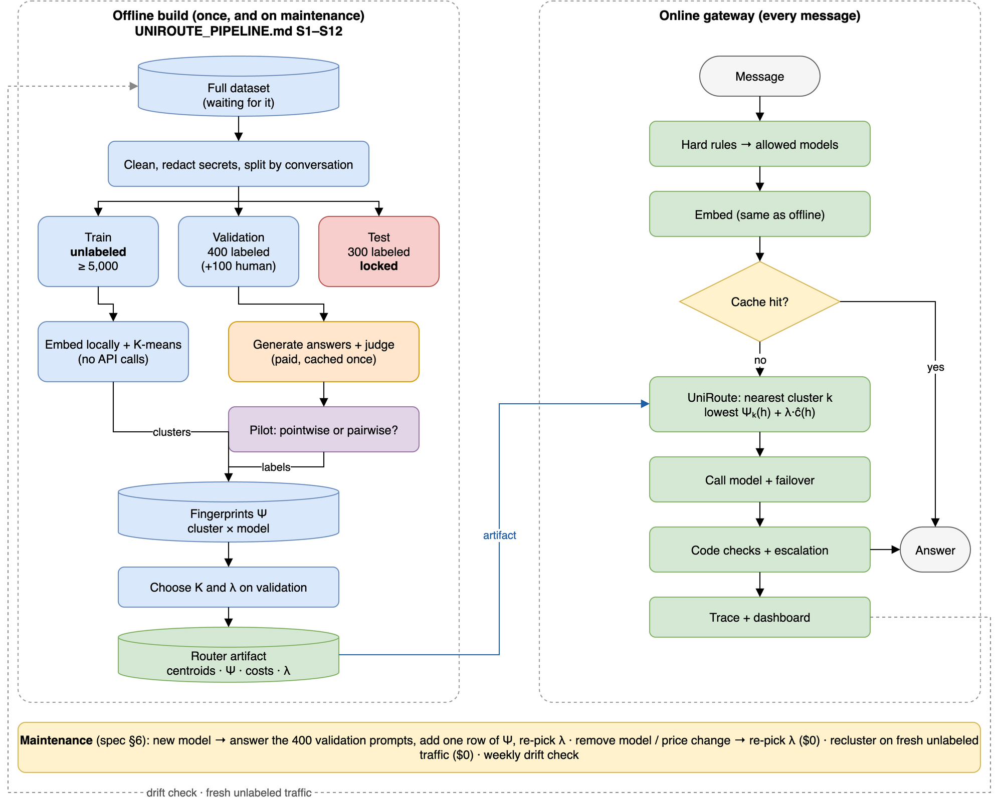

# Metis-Auto v2

An LLM router for Persian-first chatbot traffic. It tries to send each message to the cheapest model
that is good enough, using the UniRoute method (ICLR 2026). Rahnema College 2026 course project.

> **Status, 2026-11-02: in progress.** Answers and labels are done, and test labels stay sealed. The router has
> **not** been tested on real data yet and the gateway is not built. Live status: [`STATUS.md`](STATUS.md).

**Reading this as an AI agent?** Go to [For AI agents](#for-ai-agents).

## Contents

- [Results so far](#results-so-far)
- [How it works](#how-it-works)
- [Progress](#progress)
- [Quick start](#quick-start)
- [Repository map](#repository-map)
- [What is not in this repo](#what-is-not-in-this-repo)
- [Rules for everyone](#rules-for-everyone)
- [For AI agents](#for-ai-agents)

## Results so far

Measured on 400 validation prompts per model. Each model answered with the chatbot's own system
prompt, retrieved context and chat history. Answers were scored 1 to 10 by the Jev judge, and 7 or
above is a pass. Pass rates carry about ±5 points of sampling error.

| Model | Mean score | Pass rate | Cost of 300 new answers |
|---|---:|---:|---:|
| claude-sonnet-5-5 (premium baseline) | 7.35 | 65.2% | $5.17 |
| deepseek-v4-flash | 7.31 | 64.9% | $0.20 |
| gpt-5.6-luna | 7.22 | 61.2% | $0.26 |
| gemini-2.5-flash-lite | 6.86 | 53.9% | $0.13 |

Details: [`results/s6_stats.md`](results/s6_stats.md), [`results/s7_stats.md`](results/s7_stats.md).

What this does and does not show:

- DeepSeek matches Sonnet on this measure at about 1/26 of the price.
- At least one model passes on about 79% of prompts, against 65% for the best single model. That is
  the ceiling for a perfect router, not a result.
- Routing may add little over "always DeepSeek". All 4 models pass together on 41% of prompts and
  all fail together on 21%. DeepSeek and Sonnet each beat the other on only 9%. Pilot separability
  was also weak (0.111 at K = 3).

Known limits:

- **Gate 2 was missed by one item.** Judge agreement was 0.74 against a 0.75 line, κ 0.431, n = 100.
  The owner went ahead on record.
- Calibration labels came from Claude Opus, not from a human.
- The wrong-prompt check and the 20 re-labels were not done.
- 1 Sonnet answer failed and counts as the worst score. 1 prompt has no judgments because Jev refused
  it.

## How it works



1. **Prompt types (free).** Embed unlabeled real user messages locally and group them with K-means.
2. **Report cards (paid once).** Every candidate answers the validation prompts and a judge scores
   them. A model's fingerprint is its failure rate in each prompt type.
3. **Route (online).** Embed the new message, find its nearest type, and pick the model with the
   lowest `Ψ_k(model) + λ · cost(model)`.
4. **Add a model later.** It answers the same prompts, which adds one fingerprint. No retraining.

The planned gateway adds hard rules, a semantic cache, failover, escalation on bad answers, and
traces. The spec is the source of truth: [`ref/UNIROUTE_PIPELINE.md`](ref/UNIROUTE_PIPELINE.md).
A plain walkthrough is in [`PROJECT.md`](PROJECT.md). Deliberate changes are listed in
[`PLAN.md`](PLAN.md) §11.

## Progress

| Stage | State |
|---|---|
| Data, splits, embeddings, clusters (WP-01 to WP-08) | Done |
| Router and evaluation library, on synthetic data (WP-05) | Done |
| Pilot and judge choice (WP-09 to WP-11) | Done, Gate 2 missed by one item |
| Generation (WP-12) | Done, test answers sealed |
| Judging (WP-13) | Done, test labels sealed |
| Fingerprints, settings, freeze (WP-14) | Not started |
| Gateway, cache, replay, dashboard (WP-15 to WP-18) | Not started |
| Final evaluation, report, release (WP-19 to WP-21) | Not started |

Full route: [`ROADMAP.md`](ROADMAP.md). Spent about $19.06 of the $60 cap; about $21.60 expected in
total.

## Quick start

Needs [uv](https://docs.astral.sh/uv/) and Python 3.12. `uv sync` also downloads PyTorch, so it takes
a while the first time.

```bash
git clone <this repo> && cd <this repo>
git checkout TakRoute
git config core.hooksPath .githooks   # turns on the secret scan: do this before your first commit
uv sync
uv run pytest -q
```

Tests need no keys, no data and no paid calls.

| Task | Command |
|---|---|
| Lint | `uv run ruff check src scripts tests` |
| Price the next generation run, sends nothing | `uv run python scripts/s6_generate.py --set val --stage gen_main --estimate-only` |
| Rebuild the validation stats | `uv run python scripts/s6_stats.py --set val` |
| Refresh the knowledge graph after code changes | `graphify update .` |

The stage scripts read `data/`, `runs/` and `cache/`, which are not in git (see below). Paid runs also
need `.env`: copy [`.env.example`](.env.example) and ask the owner about keys.

## Repository map

| Path | What it holds |
|---|---|
| `src/metis/` | Package: `data`, `embed`, `llm`, `judge`, `router`, `eval`, `sim`, `labeling`, `obs`. `gateway` is still empty |
| `scripts/` | One script per stage: `s1_` ingest to `s7_` judge, plus reports |
| `configs/` | YAML settings. `budget.yaml` holds the money limits, `models.yaml` the prices |
| `tests/` | pytest suite |
| `results/`, `report/` | Aggregates only, no prompt or answer text |
| `work/` | One instruction file per work package, reports in `work/reports/` |
| `ref/` | Spec, papers, course brief, diagrams |
| `AGENTS.md` | Project rules, for agents and people |
| `STATUS.md` | Where we are and the exact next step |
| `MASTER_LOG.md` | Decisions (D-numbers), budget ledger, dated log |
| `graphify-out/` | Knowledge graph of the code |

## What is not in this repo

These are git-ignored and stay local:

| Folder | Holds | Why |
|---|---|---|
| `data/` | Raw chatbot data | Contains live API keys and user text |
| `runs/` | Prompts, splits, answers, labels, sealed test ids | Same text, and test ids must stay sealed |
| `cache/` | Paid call cache and spending ledger | Holds answer text |
| `qdrant/`, `models/`, `mlflow/` | Vector store, model weights, traces | Large or derived |

Sharing the embeddings: use the Qdrant snapshot from the owner, not `runs/`. Never pass on `runs/s1`,
`runs/cluster_view`, `runs/bots` or the sealed ids.

## Rules for everyone

The full list is in [`AGENTS.md`](AGENTS.md). The ones that matter most:

- **Never commit** `data/`, `runs/`, `cache/` or `.env`, or paste a key in chat.
- **The test set stays sealed.** No method, K, λ, threshold or other choice may use test prompts or
  labels. Only `scripts/eval_test.py` (WP-19, not written yet) opens them, once.
- **Paid calls need the owner's "go"** with an estimate. All go through `metis.llm.runner`, which adds
  the cache, the budget limit and automatic stops. The hard cap is $60.
- **Prompts and answers stay out of** git, `results/` and `report/`.
- **Every reported number** says measured or simulated, n, and a confidence interval.
- **Secrets:** everything sent to an API passes `metis.data.redact` and the outgoing key guard.

## For AI agents

Read in this order, and stop when you have enough:

1. [`AGENTS.md`](AGENTS.md): rules and session protocol. These override your defaults.
2. [`STATUS.md`](STATUS.md): current state and the exact next step.
3. [`ROADMAP.md`](ROADMAP.md) table, then the current `work/WP-xx-*.md`.

Machine-readable facts:

- **Run:** `uv run pytest -q` · `uv run ruff check src scripts tests`
- **Add packages:** `uv add`, never `pip install`.
- **Code search:** run `graphify query "<question>"` before grepping, and `graphify update .` after
  code changes.
- **Claude Code:** `CLAUDE.md`, `.claude/settings.json` and the `/start` and `/handoff` skills load
  automatically. Other agents should follow `AGENTS.md` §1 by hand.

Hard stops. Ask a human first:

- Any paid call, or raising a limit in `configs/budget.yaml`.
- Anything that opens `*.sealed*` files, or any test metric.
- Changing `configs/judge_config.yaml` or the judge templates, which changes the judge config id.
- Deviating from `ref/UNIROUTE_PIPELINE.md`.

If you touch a stage script, keep it resumable: a rerun must pay only for missing work, and a stopped
run must never write the final table that later stages read.
