<div align="center">

# TakRouter

**Every message goes to the right model, at the lowest cost.**

An OpenAI-compatible LLM gateway for Persian-first chatbots. It routes each message with **UniRoute** (ICLR 2026)
and adds a semantic cache, answer checks with escalation, failover, streaming and traces.

[](https://github.com/Mehrdadrahmani/metis-auto/actions/workflows/ci.yml)


**96% cheaper than sending everything to Claude Sonnet, at the same quality** (sealed test, n = 299)

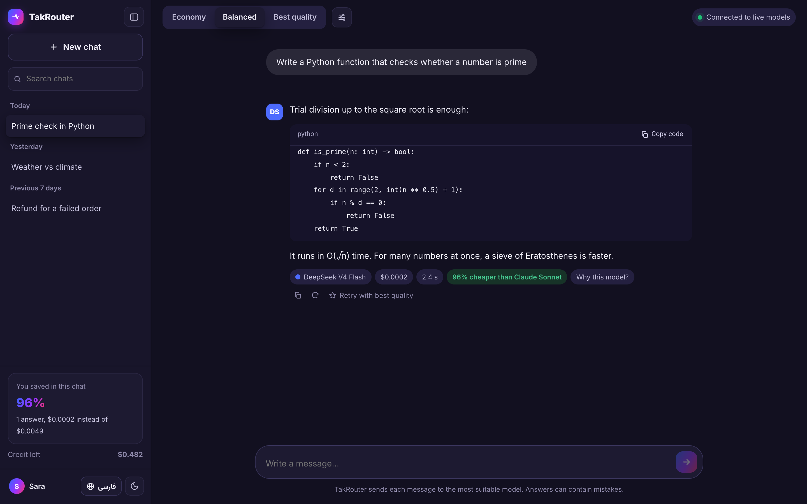

</div>

---

## Contents

- [What it does](#what-it-does)
- [Screenshots](#screenshots)
- [How it works](#how-it-works)
- [Results](#results)
- [Quick start](#quick-start)
- [API](#api)
- [Repository map](#repository-map)
- [Team](#team)
- [Rules, data and secrets](#rules-data-and-secrets)
- [For AI agents](#for-ai-agents)

## What it does

| | |
|---|---|
| **Smart routing** | Detects the topic of each message (8 clusters) and picks the model with the best quality for the price on that topic: `s(h) = Ψₖ(h) + λ·cost(h)` |
| **One API, many models** | OpenAI-compatible `/v1/chat/completions`. Use `model="takrouter"` to route, or a model id to call it directly |
| **Quality guard** | Checks every answer (empty, cut off, wrong language, bad JSON), repairs once, then escalates to a stronger model |
| **Never down** | A circuit breaker per model; if one fails, the next-best model answers (0 failed requests with a model down) |
| **Semantic cache** | The same question answered before comes back instantly and free |
| **Streaming** | Words appear as the model writes (server-sent events, OpenAI chunk format) |
| **Bring your own key** | A user can add their own Metis AI key on the site; their chats then bill their account, not their credit |
| **Add a model** | A new model answers the same 800 validation prompts and becomes one more column in Ψ; the clusters stay |
| **Transparent** | Each answer shows the model, cost, time and saving; "Why this model?" shows the scores; an optional decision trace shows every step |
| **Safe by default** | Keys are redacted before any model call; traces hold no message text; a hard budget cap is enforced in code |

## Screenshots

<table>
<tr>
<td width="50%">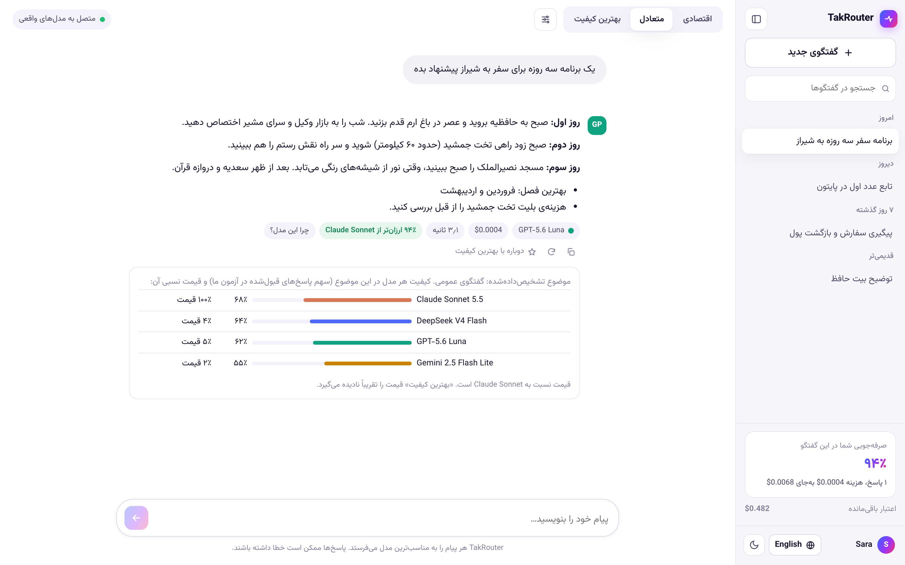<br><sub><b>Persian chat.</b> "Why this model?" shows the detected topic and each model's quality and relative price.</sub></td>
<td width="50%">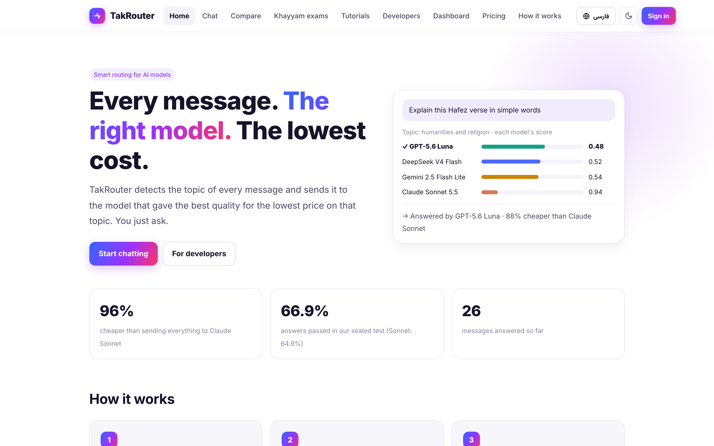<br><sub><b>Home.</b> A live counter of messages answered and money saved.</sub></td>
</tr>
<tr>
<td>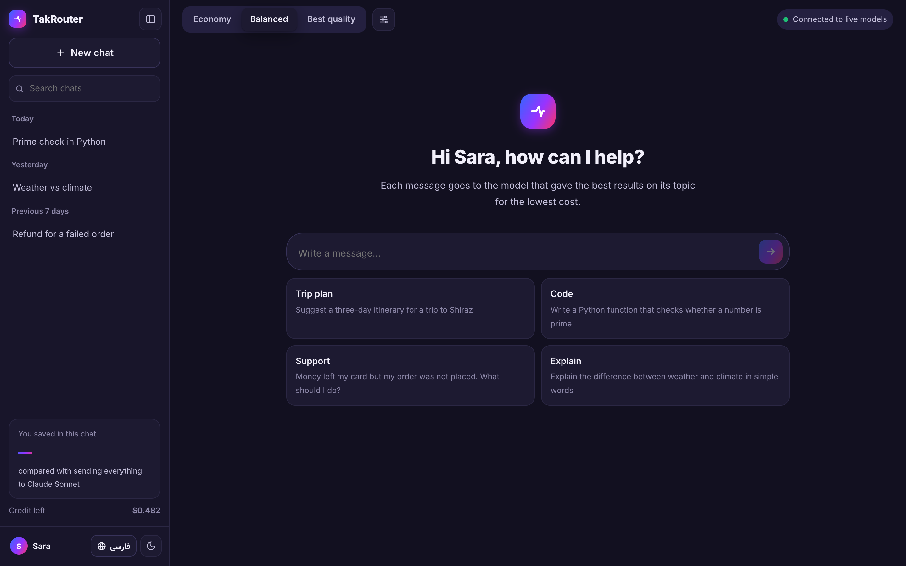<br><sub><b>New chat.</b> Claude-style layout: a collapsible sidebar, Economy / Balanced / Best quality modes, dark mode.</sub></td>
<td>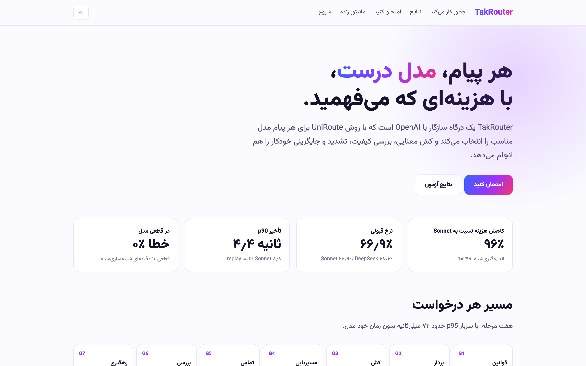<br><sub><b>Results.</b> The sealed-test numbers, measured and simulated, each with n and a CI.</sub></td>
</tr>
<tr>
<td>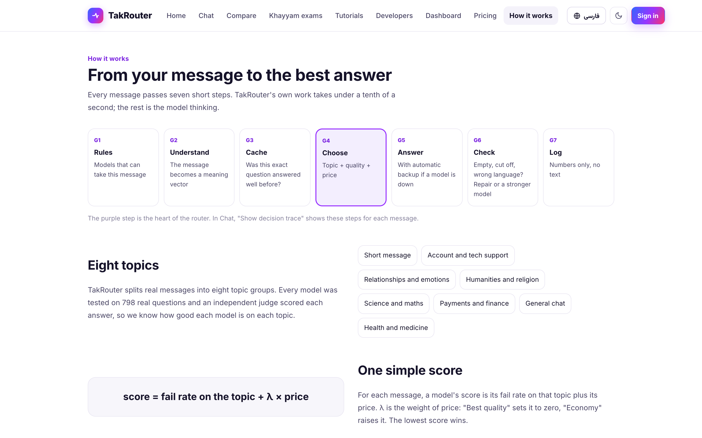<br><sub><b>How it works</b>, for users and developers.</sub></td>
<td>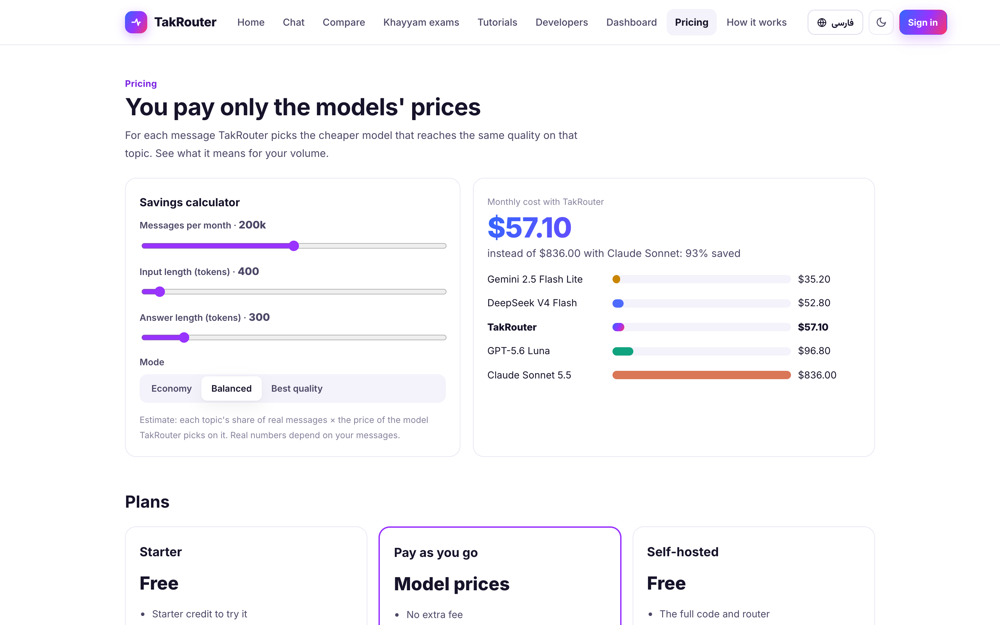<br><sub><b>Pricing.</b> Per-model prices and what routing saves.</sub></td>
</tr>
</table>

<p align="center">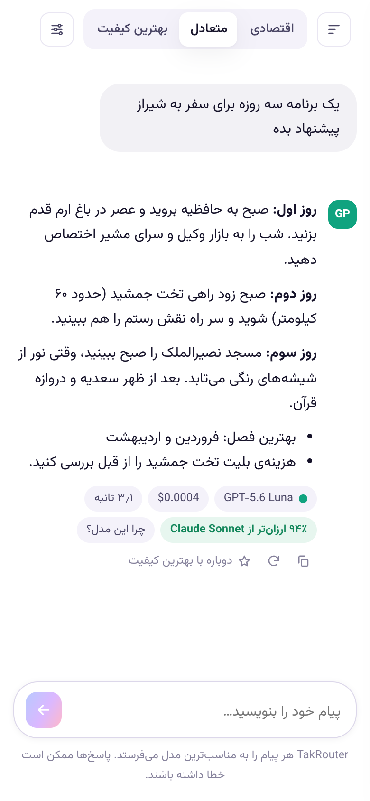<br><sub>On a phone: right-to-left layout, mixed Persian and English kept in order.</sub></p>

<sub>Screenshots of the running site; the chat pages show example conversations.</sub>

## How it works

**Build once (offline), then route every message (online).** Train prompts are clustered without labels. On the
validation set, four models answer and an AI judge scores them, which gives Ψ, the fail rate of each model in each
cluster. A new model only adds one column.

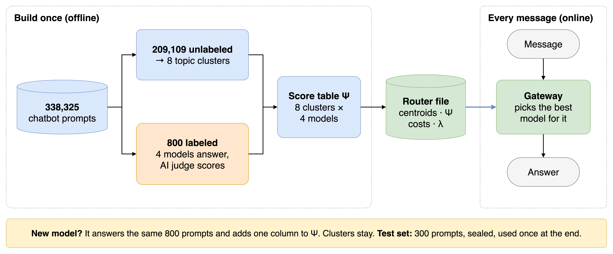

**The path of one message.** Seven steps; the gateway's own overhead is about 23 ms (p50) with the real embedder.

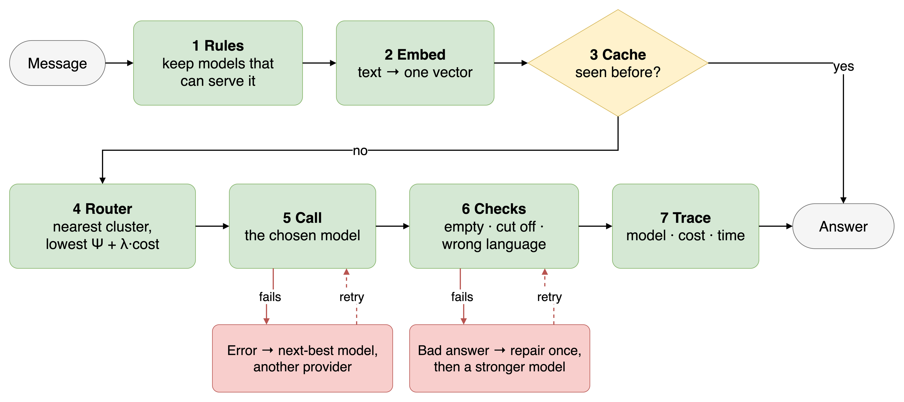

| Part | Technology |
|---|---|
| Gateway | Python 3.12, FastAPI, LiteLLM (through Metis AI), SQLite for accounts, traces and cache |
| Router | K-means on Jina v5 nano embeddings, K = 8, λ = 0.5151 (`artifacts/router_v1/`) |
| Website | Node.js (Next.js 16) in `web-node/`, with server-side language and direction for right-to-left text. The original Python-served site is in `web/` |
| Judge | GPT-5.x class, pointwise, pass at score ≥ 7 |

## Results

Final test: **299 sealed prompts**, opened once after the router and protocol were frozen (tag `pre-test`). Each
answer was scored 1 to 10 by the judge; 7 or above is a pass. Costs are measured from tokens at list prices.

| Setup | Pass | $ per 1,000 messages |
|---|---:|---:|
| **TakRouter K = 8 (shipped)** | **66.9%** | **0.69** |
| TakRouter K = 4 (comparison) | 70.2% | 5.55 |
| Always DeepSeek v4 Flash | 68.6% | 0.68 |
| Always Sonnet 5.5 (premium) | 64.9% | 16.32 |
| Always Luna | 61.9% | 0.84 |
| Always Gemini 2.5 Flash Lite | 51.8% | 0.41 |

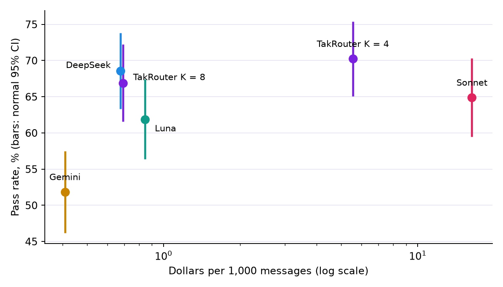

- **Against Sonnet, all 3 pre-registered criteria were met:** 95.8% cheaper; quality difference +2.0 points (95% CI −3.0 to +7.1, limit −5); simulated p90 latency 4.4 s vs 8.8 s.
- **Against always-DeepSeek, the shipped router adds no value:** −1.7 points (95% CI −3.8 to +0.3) at about the same cost. Most of the saving comes from one good cheap model. This is the most important limit of the result.
- Judge labels are noisy (5% of 60 repeats flipped pass or fail), and pilot agreement missed its line (0.74 vs 0.75, Opus labels, not human).
- **Semantic cache:** no threshold met the 2% wrong-hit target. At 0.97 about 10% of meaning hits were judged wrong (95% CI 5.5% to 17.4%). See `results/cache_threshold.md`.
- **Check on true answers (Khayyam exams, n = 1,100):** UniRoute beat ZeroRouter on area by 0.020 (95% CI 0.001 to 0.044), but at the chosen λ scored 55.0% vs 56.2% for the best single model. See `results/khayyam/README.md`.

<details>
<summary><b>How the evaluation was kept honest</b></summary>

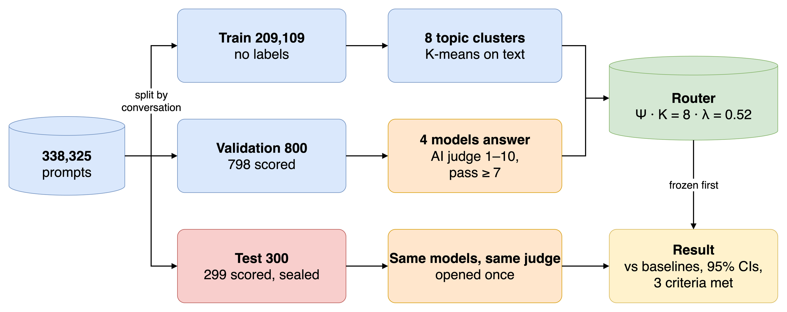

| Measured | Value |
|---|---:|
| Gateway overhead, real embedder | p50 23 ms, p95 72 ms |
| One model down | 0 failed requests in tests and replay |
| Real latency, 50 messages | TakRouter p90 10.6 s, Sonnet 18.1 s |

Full report: [`report/REPORT.md`](report/REPORT.md).
</details>

## Quick start

You need [uv](https://docs.astral.sh/uv/) with Python 3.12, and Node.js 20 or later for the website.

**1. Try it without keys or data (free).** The provider is a mock, answers are placeholders, and a fake embedder
replaces Jina, so routing in this mode is not real.

```bash
uv sync
uv run pytest -q
TAKROUTER_FAKE_EMBED=1 uv run uvicorn metis.gateway.app:app --port 8000
```

**2. The website (Node.js).** The site runs on its own port and passes every API call to the gateway.

```bash
cd web-node
npm ci
npm run build && npx next start -p 3001        # open http://localhost:3001
```

(`TAKROUTER_GATEWAY=http://host:port npm run build` for another gateway address. The gateway also serves the
original site from `web/` at `http://localhost:8000`.)

**3. The real product: live models, real routing.**

```bash
uv run python scripts/fetch_model.py               # once: the Jina nano embedder
cp .env.example .env                               # then set METIS_BASE_URL and METIS_API_KEY; never commit .env
TAKROUTER_PROVIDER=live uv run uvicorn metis.gateway.app:app --port 8000
```

Live spending goes through the budget guard (stage `product` in `configs/budget.yaml`). When it is used up, the API
answers 402 and the site says so. The first account to sign up becomes the admin.

| Task | Command |
|---|---|
| Replay on validation ($0, needs `runs/`) | `PYTHONPATH=scripts uv run python scripts/s18_replay.py` |
| Refresh site numbers | `PYTHONPATH=scripts uv run python scripts/build_web_data.py` |
| Latency benchmark | `uv run python scripts/gateway_latency.py` |
| Website checks ($0) | `cd web-node && node scripts/check.mjs` (more in `web-node/README.md`) |

## API

Any OpenAI client works. Use a key from the site's Account page (`tk-…`).

```python
from openai import OpenAI

client = OpenAI(base_url="http://localhost:8000/v1", api_key="tk-...")

reply = client.chat.completions.create(model="takrouter", messages=[{"role": "user", "content": "سلام"}])
print(reply.model, reply.takrouter)          # the chosen model, cluster, scores, cost, cache, latency

for chunk in client.chat.completions.create(model="takrouter", messages=[{"role": "user", "content": "Hi"}], stream=True):
    print(chunk.choices[0].delta.content or "", end="")
```

| Option | What it does |
|---|---|
| `model="takrouter"` or a model id (`deepseek-v4-flash`, …) | Route, or skip the router |
| `stream=True` | Server-sent events; a `takrouter.event = "reset"` chunk means a backup model started over; the last chunk carries the full result |
| `metadata.lambda` | Quality vs price for this request (0 = best quality) |
| `metadata.trace = true` | Every step of the decision in `takrouter.trace` |
| Headers `X-Metis-Chatbot`, `X-Metis-Session` | Cache namespace and session stickiness |
| `GET /v1/router?lam=` · `GET /v1/budget` · `GET /health` | Each cluster's pick, the spending left, breaker states |
| `PUT /auth/provider-key` · `POST /auth/provider-key/test` | Store and test the user's own Metis key (encrypted; only the last 4 characters are shown again) |

## Repository map

| Path | What it holds |
|---|---|
| `src/metis/` | Package: `data`, `embed`, `llm`, `judge`, `router`, `gateway`, `eval`, `sim`, `labeling`, `obs`, `onboard`, `khayyam` |
| `web-node/` | The website on Node.js (Next.js 16): pages, right-to-left fixes, chat, account; browser tests in `scripts/` |
| `web/` | The original website, served by the gateway |
| `scripts/` | One script per stage: `s1_` ingest to `s7_` judge, plus reports |
| `artifacts/` | Frozen routers: `router_v1` (shipped), `router_v1_k4`, `router_khayyam` |
| `configs/` | YAML settings. `budget.yaml` holds the money limits, `models.yaml` the prices |
| `tests/` | pytest suite (mock provider, no keys) |
| `results/`, `report/` | Aggregates only, no prompt or answer text |
| `diagrams/`, `docs/` | Diagrams (draw.io) and screenshots |
| `deck/` | Pitch deck (Persian) |
| `work/`, `ref/` | Work packages and reports; spec, papers, course brief |
| `AGENTS.md`, `STATUS.md`, `MASTER_LOG.md` | Project rules, current state, decisions and budget ledger |

## Team

**Synapse**, Rahnema College 2026: Farzaneh Nademi · Kimia Komeili · Roham Ghlabi · Mehrdad Rahmani.
Mentor: Peyman Naseri.

TakRouter (this repository) was built by Mehrdad Rahmani.

## Rules, data and secrets

These folders are git-ignored and stay local:

| Folder | Holds | Why |
|---|---|---|
| `data/` | Raw chatbot data | Contains live API keys and user text |
| `runs/` | Prompts, splits, answers, labels, sealed test ids, accounts | Same text, and test ids must stay sealed |
| `cache/` | Paid call cache and spending ledger | Holds answer text |
| `qdrant/`, `models/`, `mlflow/` | Vector store, model weights, traces | Large or derived |

The full rules are in [`AGENTS.md`](AGENTS.md). The ones that matter most:

- **Never commit** `data/`, `runs/`, `cache/` or `.env`, and never paste a key in chat.
- **The test set stays sealed.** No method, K, λ, threshold or other choice may use test prompts or labels. Only `scripts/eval_test.py` opens them, and that one look is done.
- **Paid calls need the owner's "go"** with an estimate. All go through `metis.llm.runner` (cache, budget limit, automatic stops). The hard cap is $60.
- **Prompts and answers stay out of** git, `results/` and `report/`. Every reported number says measured or simulated, n, and a CI.
- **Secrets:** everything sent to an API passes `metis.data.redact` and the outgoing key guard.

## For AI agents

Read in this order, and stop when you have enough:

1. [`AGENTS.md`](AGENTS.md): rules and session protocol. These override your defaults.
2. [`STATUS.md`](STATUS.md): current state and the exact next step.
3. [`ROADMAP.md`](ROADMAP.md) table, then the current `work/WP-xx-*.md`.

- **Run:** `uv run pytest -q` · `uv run ruff check src scripts tests`
- **Add packages:** `uv add`, never `pip install`.
- **Code search:** `graphify query "<question>"` before grepping, `graphify update .` after code changes.
- **Claude Code:** `CLAUDE.md`, `.claude/settings.json` and the `/start` and `/handoff` skills load automatically.

Hard stops (ask a human first): any paid call or a higher limit in `configs/budget.yaml`; anything that opens
`*.sealed*` files or a test metric; changing `configs/judge_config.yaml` or the judge templates; deviating from
`ref/UNIROUTE_PIPELINE.md`. A stage script must stay resumable: a rerun pays only for missing work, and a stopped
run never writes the final table that later stages read.
