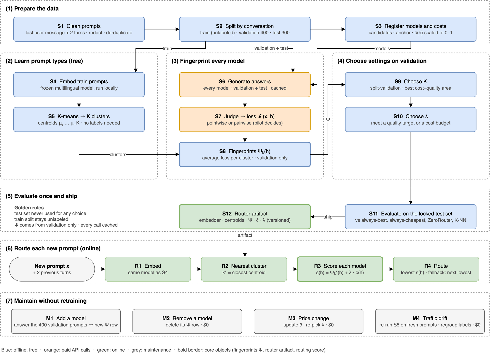

# UniRoute, explained with one diagram



Diagram: `diagrams/05-uniroute.drawio` (`.png` / `.pdf`). Source: [`UNIROUTE_PIPELINE.md`](../UNIROUTE_PIPELINE.md),
based on Jitkrittum et al., *Universal Model Routing for Efficient LLM Inference*, ICLR 2026.
The step codes below (S1–S12, R1–R4, M1–M4) match the boxes in the diagram and the spec's numbering. The diagram has seven bands: 1 prepare, 2 learn prompt types, 3 fingerprint every model, 4 choose settings, 5 evaluate and ship, 6 route, 7 maintain.

---

## The idea in one sentence

For every prompt, pick the model that minimizes

```
predicted loss on this kind of prompt  +  λ × cost
```

where "this kind of prompt" is a **cluster** of similar prompts, and each model's loss per cluster
is its **fingerprint**, measured once on a small labeled validation set.

Two things make this useful:

- **Prompts** are described by which cluster they fall in (found without labels, for free).
- **Models** are described by how badly they do in each cluster (their fingerprint).

A new model only needs a fingerprint. Nothing is retrained.

---

## A. Build the router once (offline): bands 1–5

### S1 Clean prompts

The routable unit is the last user message plus up to 2 previous turns. Empty, junk and spam messages are removed, secrets and personal data are stripped, the language is tagged, and duplicates are dropped.

### S2 Split by conversation: the three data splits

| Split | Labeled? | Used for |
|---|---|---|
| **Train** (large, ideally ≥ 5,000) | **No** | Only to find prompt types (S5) |
| **Validation** (~400, up to 800) | Yes | The **only** source of fingerprints (S8) and of the settings K and λ (S9, S10) |
| **Test** (~200–500) | Yes | **Locked.** Used once, for the final report. Never for any choice |

Splits are made **by conversation** (or user / time), so one conversation never lands in two splits.

### S3 Register models and costs

Every candidate model is registered with its prices. Its cost per prompt c(h) comes from real token counts on the validation set and is scaled so the most expensive model = 1: **ĉ(h) = c(h) / max c**. For pairwise labels, the strongest model is the **anchor**.

### S4 Embed train prompts

Every prompt x (the last user message plus up to 2 previous turns) is turned into a vector φ(x) by a
**frozen multilingual embedder running locally** (BGE-M3 / multilingual-E5 class). The vector is
L2-normalized. No API calls.

### S5 K-means → K clusters (prompt types)

K-means groups the **unlabeled** train prompts into K clusters with centres μ₁ … μ_K
(k-means++, ≥ 10 restarts, fixed seed). These clusters are the "prompt types", e.g. coding, Persian
literature, casual chat. We read 10 prompts per cluster and give each a name.

Why on train and not on validation? The validation set is small; clustering it directly would fit its
noise (the paper's warning, §5.1). Train is large and costs nothing because it needs no labels.

**Assigning validation prompts** (used in S8)

Each validation prompt goes to its nearest centre: k(x) = argmax_k φ(x)ᵀμ_k. This gives groups
C₁ … C_K. **Rule:** every group must have **at least 50** validation prompts; otherwise that K is not
allowed. That's why K can be at most N_val / 50 (8 for 400 validation prompts).

### S6 Generate answers (paid)

Every candidate model answers every validation (and test) prompt **once**, with the same settings for
all models. Every answer is stored under a fixed key and never requested again. A failed answer
counts as the worst label.

### S7 Judge → loss (paid)

A strong judge (not one of the candidates, temperature 0, model names hidden) turns each answer into a
**loss** ℓ(x, h) between 0 (good) and 1 (bad). There are two ways; the **pilot** picks one:

| | Pointwise | Pairwise |
|---|---|---|
| Judge sees | One answer | The answer and the **anchor**'s answer (the strongest model, answers frozen) |
| Judge returns | Score 1–10 | Win / tie / lose vs the anchor, judged in both orders |
| Loss | 1 if score < τ, else 0 (τ chosen on the human-labeled set, default 7) | 1 − o(x, h), where o = 1 win, 0.5 tie, 0 lose (averaged over both orders) |
| Judge calls per answer | 1 | 2 |

Before trusting the judge: on 100 human-labeled items, judge and humans must agree **≥ 75%**.

### S8 Fingerprints Ψ

For each model h and cluster k, Ψ_k(h) = the model's **average loss on the validation prompts in
cluster k**.

- **Pointwise:** a smoothed fail rate. Small clusters are pulled a little toward the model's overall
  fail rate f̄(h):

  ```
  Ψ_k(h) = ( sum of losses of h in C_k  +  α · f̄(h) ) / ( |C_k| + α ),   α = 2
  ```

  With α = 0 this is exactly the paper's equation 12.
- **Pairwise:** a Bradley–Terry model per cluster gives Ψ_k(h) = P(anchor beats h in cluster k).
  The anchor's own row is always 0.5.

Each model's row is its **fingerprint**. The table in the diagram (spec Appendix B) shows three models:
S (strong, the anchor), M (medium) and C (cheap). Next to it is **ĉ(h)**, each model's cost per prompt
divided by the most expensive model's cost, so costs run from 0 to 1.

### S9 Choose K and S10 Choose λ (validation only)

- **K (number of clusters):** try K = 1 (no clusters, a baseline) and K = 3 … N_val / 50. For each K,
  split the validation set in half at random, build the fingerprints on one half, route the other half,
  and measure the area under the cost–quality curve. Repeat 5 times, average, swap halves. Keep the best
  K (ties → smaller K).
- **λ (price weight):** λ = 0 means "quality only" (always the best model); a large λ means "price only"
  (always the cheapest). We sweep about 60 values and pick either the largest λ that still meets a
  **quality target**, or the smallest λ that fits a **cost budget**.

### S11 Evaluate once, S12 Router artifact

S11 is the **only** time the test set is used (see "How we know it works" below). S12 packages a versioned router artifact: the method (and τ or anchor id), embedder id, K, centroids and cluster names, the fingerprint table Ψ with per-cluster counts, ĉ per model with the price snapshot, λ and its target, and hashes of the validation set, generation config and judge config.

---

## B. Route each new prompt (online): band 6

| Step | What happens |
|---|---|
| R1 Embed | Same preprocessing and the same embedder as S4 |
| R2 Nearest cluster | k* = argmax_k φ(x)ᵀμ_k: which prompt type is this? |
| R3 Score each model | For every available model: **s(h) = Ψ_k*(h) + λ · ĉ(h)** (paper eq. 8 / 11) |
| R4 Route | Lowest s(h) wins; a tie goes to the cheaper model; if the call fails or times out, use the next-lowest s(h) |

Then log the prompt id, k*, the chosen model, all scores and the artifact version.

### Worked example (spec Appendix B, λ = 0.4)

| Prompt type | s(S) | s(M) | s(C) | Route to |
|---|---|---|---|---|
| Casual chat | 0.50 + 0.40 = 0.90 | 0.52 + 0.12 = 0.64 | 0.55 + 0.02 = **0.57** | **C** (cheap) |
| Persian literature | 0.50 + 0.40 = **0.90** | 0.80 + 0.12 = 0.92 | 0.92 + 0.02 = 0.94 | **S** (strong) |

The rule is the same for both prompts, but the answer differs:

- In **casual chat**, C's loss (0.55) is almost the anchor's (0.50), and it costs 20× less → C wins.
- In **Persian literature**, C and M lose to the anchor most of the time (0.92, 0.80) → paying for S is
  worth it.

With λ = 0, S would win both (lowest loss). With a very large λ, C would win both (lowest cost). λ
moves the system along the cost–quality curve.

---

## C. Maintain (no retraining): band 7

### M1 Add a model

1. The new model N answers the **same ~400 validation prompts**.
2. The judge grades them (pairwise: against the **stored** anchor answers, so the anchor doesn't need
   to be called again).
3. Average per cluster → **one new row Ψ(N)** in the fingerprint table.
4. Re-pick λ (free). N is now routable.

Nothing else changes: the clusters and every other model's row stay the same.
**Cost:** 800 calls pointwise (400 answers + 400 grades), or 1,200 pairwise (400 + 800).

| Step | What to do | API calls |
|---|---|---|
| M2 Remove a model | Delete its row; re-pick λ | 0 |
| M3 Price change | New ĉ; re-pick λ | 0 |
| Change τ (pointwise) | Recompute losses from the stored scores | 0 |
| M4 Traffic drift | Re-run S5 on fresh unlabeled prompts; regroup the stored validation labels | 0 |

The paid steps (S6, S7) don't depend on K, so changing K or reclustering only regroups labels we already
have.

---

## Why it doesn't fool itself (the golden rules)

1. The **test set is never used for any choice** (method, K, λ, τ, rubric, thresholds).
2. Every model and judge call is **cached** and never repeated.
3. Answers are generated once and **shared by both label methods**.
4. Pairwise: the **anchor's answers are frozen**.
5. Pointwise: the raw 1–10 score is stored, so τ can change without new judge calls.
6. The **train split is unlabeled**; it is only for K-means.
7. **Fingerprints come only from validation labels.**
8. All randomness uses a recorded seed.

---

## How we know it works

On the locked test set, UniRoute is compared with always-best, always-cheapest, **ZeroRouter** (no
clusters; mixes the two best-value models) and **K-NN** (uses the most similar validation prompts):

- **Deferral area:** the area under the cost–quality curve, swept over λ. Higher is better.
- **QNC:** the lowest cost (relative to the best single model) at which routing matches the best
  model's quality. Lower is better.
- **Experiment mode:** about 1/3 of the models are hidden while K and λ are chosen, then the router
  routes only among them. This tests UniRoute's main claim: it works for models it has never seen.

If UniRoute is no better than ZeroRouter, the clusters aren't separating model strengths: inspect Ψ,
try another embedder or K (spec §12).

---

## Paper vs our pipeline

| Element | Paper | `UNIROUTE_PIPELINE.md` |
|---|---|---|
| Labels | Right/wrong from benchmark answers | Judge: pointwise pass/fail or pairwise vs anchor; pilot chooses |
| Per-cluster score | Error rate (eq. 12); Bradley–Terry on Chatbot Arena (App. G.4) | Smoothed fail rate (= eq. 12 at α = 0) or BT P(lose to anchor) |
| Choosing K | Labels from training models on the train split | Split-validation on the validation split |
| Routing rule | Eq. 8 / 11 | Identical |
| λ | Sweep / line search (App. E) | Identical |
| Metrics | Deferral area, QNC | Identical |
