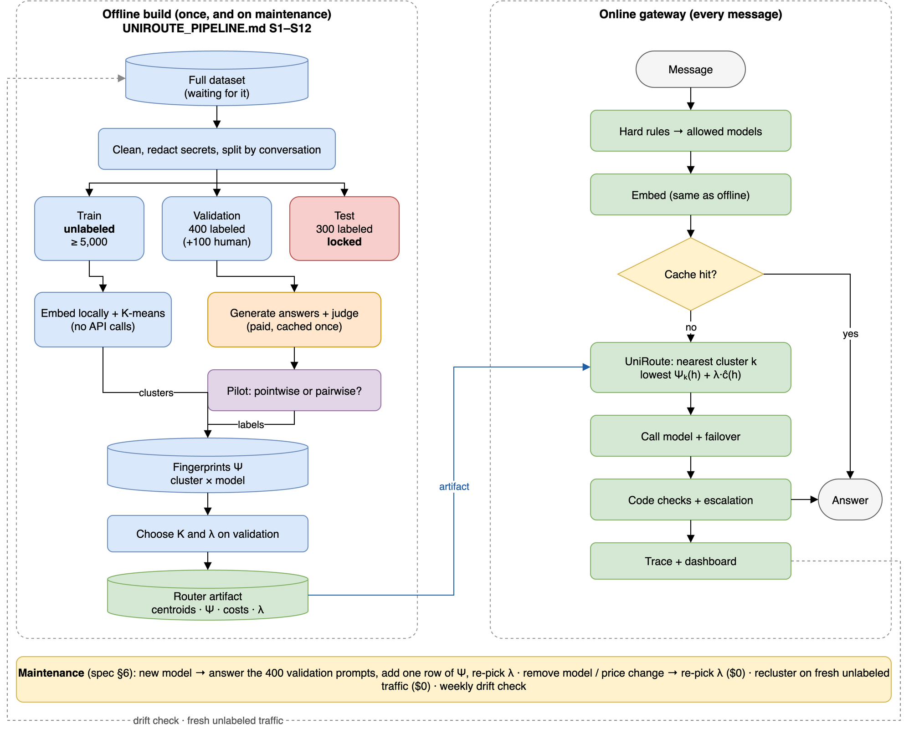
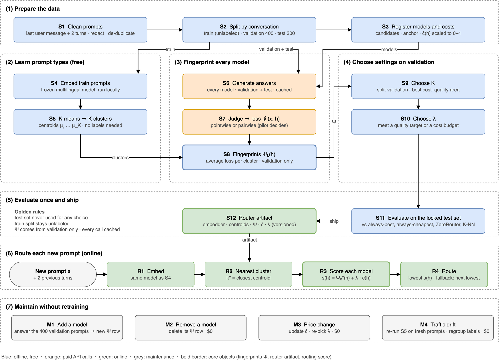
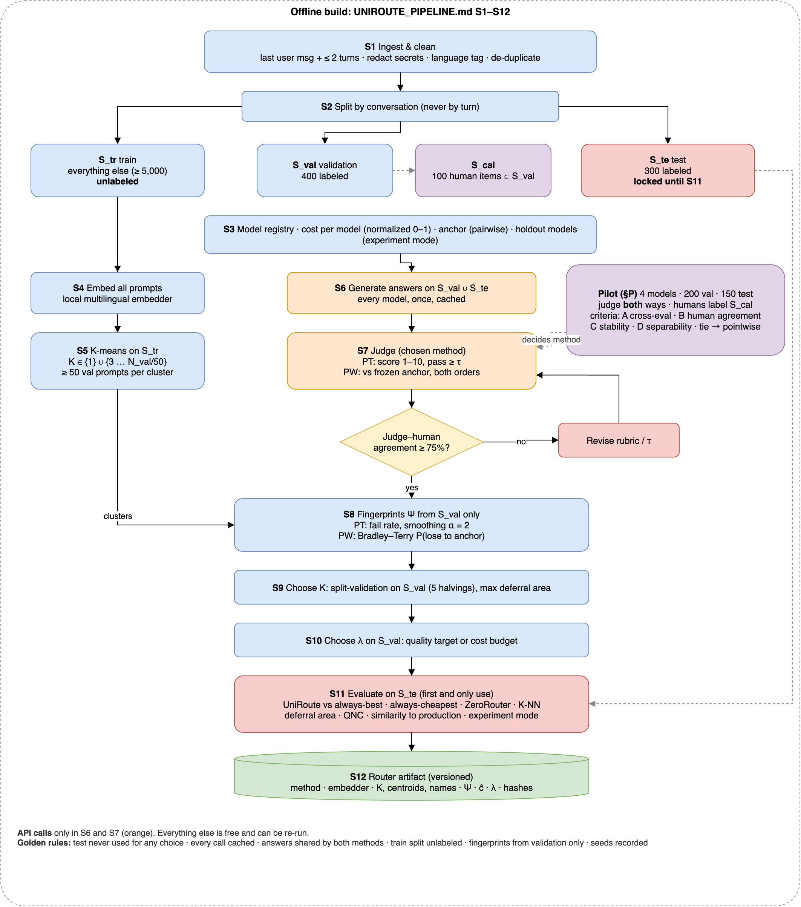
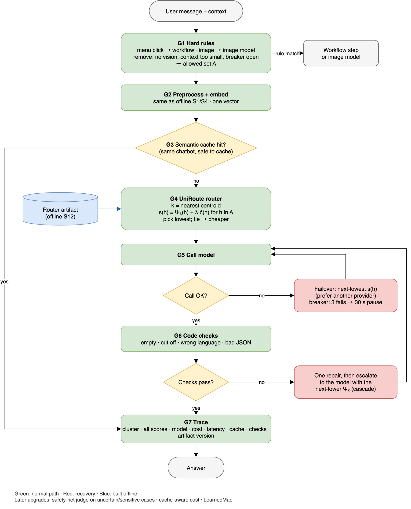
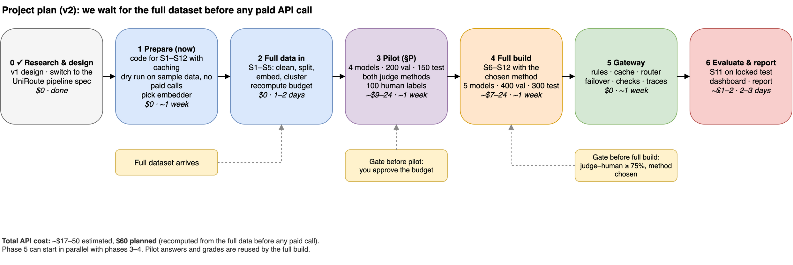
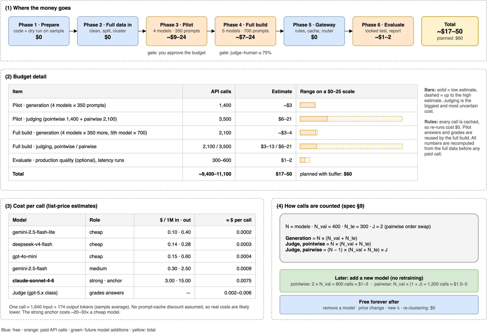

# Proposal: Metis-Auto v2, a measured LLM router built on UniRoute

**Date:** 2026-10-19 · **Course:** Rahnema College 2026 · **Status:** proposal v2, waiting for the full dataset
**PDF version:** `proposal/latex/proposal.pdf` · **Router spec:** `UNIROUTE_PIPELINE.md` ·
**Design:** `docs/design.md` · **Previous version (v1):** `../metis-v2/archive/v1-2026-10-17/`

---

## 1. Summary

Chatbot platforms pay very different prices for different AI models. A strong model can cost 10–20
times more than a small one for the same message, while many messages are simple. The course asks for
a router that picks a cheap model when that is enough and a strong model when it isn't, **without
sacrificing quality**.

We build the router exactly as in **UniRoute** (Jitkrittum et al., Google, **ICLR 2026**), following
our specification `UNIROUTE_PIPELINE.md`:

1. Group a **large, unlabeled** set of real prompts into K clusters (free).
2. Have each candidate model answer a **small labeled validation set** (400 prompts), grade the answers
   with an LLM judge checked by humans, and record each model's **fail rate per cluster** (its
   "fingerprint").
3. Route each new message to the model with the lowest **fail rate + λ × cost** in its cluster.
4. Add a new model later by grading it on the same 400 prompts. **No retraining.**

The router sits inside a gateway with the parts the brief requires: hard rules, semantic cache,
failover and escalation, and traces.

**We wait for the full dataset before any paid API call.** The 377-turn sample is too small for this
method (see §2). **Estimated API cost: ~$17–50, $60 planned**, recomputed from the full data before we
spend anything.

---

## 2. Why v2

v1 (2026-10-17) used the 377 sample turns for everything: clustering, report cards, choosing settings
and the final numbers. Comparing it with the paper and our pipeline spec showed three problems:

| Problem in v1 | Fix in v2 |
|---|---|
| Clusters and report cards came from the **same** labeled data, which overfits | Clusters from a large **unlabeled** train split; report cards only from the validation split |
| K and λ were tuned on the same data we reported on | A **locked test set**, used once at the end |
| Answers were graded against production's answer, which came from 18 different models | Pointwise grading or pairwise vs a fixed **anchor** model, chosen by a **pilot** |

The paper's setting needs thousands of unlabeled prompts and ~700 labeled ones. Only the full dataset
can provide that.

---

## 3. Problem

| Need (brief, dataset) | Why it's hard |
|---|---|
| Users shouldn't choose models ("AI decision fatigue") | The system must judge each message automatically and cheaply |
| Cut cost without hurting quality | Quality is easy to claim and hard to measure |
| Mostly Persian traffic | Judges and routers are checked mainly in English; we found no router research on Persian |
| Four very different usage types | The design must generalize, not be tuned to one chatbot |
| Reliability and observability | Provider outages, rate limits; every decision explainable |

---

## 4. Solution overview



- **Offline build** (spec S1–S12): split → cluster the unlabeled train split → generate and grade
  answers on validation and test → fingerprints → choose K and λ → evaluate once on test → package a
  versioned **router artifact**.
- **Online gateway:** hard rules → embed → semantic cache → **UniRoute router** → call with failover →
  code checks and escalation → trace.
- **Maintenance:** new model = one new fingerprint row; price change = re-pick λ; recluster on fresh
  unlabeled traffic for free.

---

## 5. How UniRoute works



Full walkthrough: `docs/uniroute-explained.md`. Step codes match the diagram and the spec.

| Band | Steps | What happens |
|---|---|---|
| 1 Prepare | S1 · S2 · S3 | Clean prompts (last message + 2 turns); split by conversation into **train (unlabeled)**, validation 400, test 300 (locked); register models, anchor and costs ĉ(h) ∈ [0, 1] |
| 2 Prompt types (free) | S4 · S5 | Embed the train prompts with a local multilingual model; K-means finds K clusters (centroids) without labels |
| 3 Fingerprints (paid) | S6 · S7 · S8 | Every model answers validation + test once; the judge turns each answer into a loss (pointwise or pairwise, chosen by the pilot); **Ψ_k(h)** = model h's average loss on the validation prompts of cluster k |
| 4 Settings | S9 · S10 | K by split-validation; λ for a quality target or a cost budget; validation only |
| 5 Evaluate and ship | S11 · S12 | One evaluation on the locked test set vs always-best, always-cheapest, ZeroRouter and K-NN; a versioned router artifact |
| 6 Route (online) | R1–R4 | Embed → nearest cluster k* → score **s(h) = Ψ_k*(h) + λ·ĉ(h)** → route to the lowest (fallback: next lowest) |
| 7 Maintain | M1–M4 | Add a model (one new Ψ row), remove a model, price change, traffic drift. **No retraining** |

**Worked example** (spec Appendix B, λ = 0.4):

| Prompt type | S (strong, anchor) | M (medium) | C (cheap) | Route to |
|---|---|---|---|---|
| Casual chat | 0.50 + 0.40 = 0.90 | 0.52 + 0.12 = 0.64 | 0.55 + 0.02 = **0.57** | **C** |
| Persian literature | 0.50 + 0.40 = **0.90** | 0.80 + 0.12 = 0.92 | 0.92 + 0.02 = 0.94 | **S** |

In chat the cheap model is almost as good as the anchor and 20× cheaper, so it wins. In literature its
loss is much higher, so paying for S is worth it. λ = 0 would always pick S; a very large λ would
always pick C.

---

## 6. Offline build



| Step | What | API calls |
|---|---|---|
| S1 Clean | Routable prompt = last user message + up to 2 earlier turns; redact secrets; language tag; de-duplicate | 0 |
| S2 Split | **By conversation.** Train (unlabeled, ideally ≥ 5,000) · validation 400 · test 300 (locked) · calibration 100 ⊂ validation | 0 |
| S3 Models | 5 candidates; cost per model from real token counts, normalized 0–1; anchor = strongest | 0 |
| S4–S5 Cluster | Local multilingual embedder; K-means on train for K ∈ {3 … N_val/50} (+ K = 1 baseline); ≥ 50 validation prompts per cluster | 0 |
| S6 Generate | Every model answers validation + test once, with its chatbot's own system prompt and context; cached | paid |
| S7 Judge | **Pointwise** (score 1–10, pass ≥ τ) or **pairwise** vs the anchor (both orders); judge–human agreement ≥ 75% | paid |
| S8 Fingerprints | Fail rate per cluster (smoothing α = 2; α = 0 is the paper's eq. 12), or Bradley–Terry P(lose to anchor) | 0 |
| S9–S10 Settings | K by split-validation on the validation set; λ for a quality target or a cost budget | 0 |
| S11 Evaluate | On the locked test set only (§8) | 0 |
| S12 Package | Router artifact: embedder, centroids, cluster names, fingerprints, costs, λ | 0 |

**Candidate models (5):** gemini-2.5-flash-lite, deepseek-v4-flash, gpt-4o-mini, gemini-2.5-flash,
claude-sonnet-4-6 (strong; anchor). **Judge:** a strong Persian-capable model outside the pool,
temperature 0, blind to model names.

**The pilot** (spec §P) runs first, on part of the full data: 4 models, 200 validation and 150 test
prompts, **both** grading methods on the same answers, and 100 human labels. It picks the method by
(A) routing quality under both measures, (B) agreement with humans, (C) stability of the fingerprints,
(D) whether the labels can tell models apart. Ties go to pointwise, which is cheaper. Everything the
pilot pays for is reused by the full build.

**Routing rule** (paper eq. 8 and 11): for a message in cluster *k*,

```
route to  argmin over models h of   Ψ_k(h) + λ · ĉ(h)
```

where Ψ_k(h) is model h's fail rate (or loss vs the anchor) in cluster k, and ĉ(h) is its normalized cost.

---

## 7. Online gateway



| Stage | What it does |
|---|---|
| G1 Hard rules | Menu clicks → workflow step; images → image model; remove models without vision, with too small a context window, or with an open circuit breaker |
| G2 Embed | Same preprocessing and embedder as offline; one vector |
| G3 Cache | Same chatbot and language only; never follow-ups, personal or sensitive content; threshold for ≤ 2% false hits |
| G4 Router | Nearest cluster; lowest Ψ_k(h) + λ·ĉ(h) among allowed models |
| G5 Call | On error → next-lowest score, preferably another provider; circuit breaker (3 failures → 30 s pause) |
| G6 Checks | Free code checks (empty, cut off, wrong language, bad JSON) → one repair → escalate to the next-lower-loss model (the brief's cascade) |
| G7 Trace | Cluster, all scores, model, cost, latency, cache hit, checks, artifact version |

---

## 8. Evaluation

All results come from the **locked test set**, used once.

| Strategy | What it is |
|---|---|
| Always-best | The strongest model for everything (the brief's premium baseline) |
| Always-cheapest | The cheapest model for everything |
| ZeroRouter | No clusters; mixes the two best-value models (paper's baseline) |
| K-NN | Uses the most similar validation prompts (paper's baseline) |
| **UniRoute (K-means)** | Our router |
| Production | Cost and similarity only (what actually happened) |

**Metrics:** area under the cost–quality (deferral) curve; **QNC** (lowest cost at which routing
matches the best single model); cost saved at equal quality; quality per cluster and per category;
routing share per model; semantic similarity to production's answers (the brief's metric); cost per
1,000 queries; p50 / p90 latency; cache hit rate.

**Simulating new models (experiment mode):** hide ~1/3 of the models while choosing K and λ, then route
only among them. This tests UniRoute's main claim.

**Overfitting checks (all free):** locked test set; K by split-validation; K = 1 baseline; fingerprint
stability; separability; validation-vs-test gap.

**Success criteria**

- UniRoute's curve area ≥ ZeroRouter's and K-NN's on the test set.
- At least 40% cheaper than always-best at no more than 2 points lower quality.
- p90 latency no worse than always-best.
- Every number labeled measured or simulated, with confidence intervals.

**Honest framing:** with a fixed set of models, the paper finds UniRoute only about as good as simpler
routers (its App. G.5). Its advantage is adding models without retraining. We report the comparison
either way.

---

## 9. Plan and budget



| Phase | What | API cost | Time |
|---|---|---|---|
| **0** ✓ | Research, v1 design, switch to the UniRoute pipeline spec | $0 | done |
| **1** | **Now, while waiting:** code for S1–S12 with caching; dry run on the sample data with no paid calls; choose the embedder | $0 | ~1 week |
| **2** | Full data arrives: S1–S5 (clean, split, embed, cluster); recompute the budget | $0 | 1–2 days |
| **3** | Pilot: 4 models, 200 val, 150 test, both grading methods, 100 human labels | ~$9–24 | ~1 week |
| **4** | Full build S6–S12 with the chosen method: 5 models, 400 val, 300 test | ~$7–24 | ~1 week |
| **5** | Gateway: rules, cache, router, failover, checks, traces (can overlap 3–4) | $0 | ~1 week |
| **6** | Evaluate on the locked test set; dashboard; report | ~$1–2 | 2–3 days |
| **Total** | | **~$17–50 (plan $60)** | **~4–5 weeks after the data arrives** |

**Gates:** you approve the recomputed budget before the pilot; the judge must agree with humans ≥ 75%
before the full build.

**Budget detail**



| Item | Calls | Estimate |
|---|---|---|
| Pilot generation (3 cheap models + anchor × 350 prompts) | 1,400 | ~$3 |
| Pilot judging (pointwise 1,400 + pairwise 2,100) | 3,500 | ~$6–21 |
| Full-build generation (4 models × 350 more prompts, 5th model × 700) | ~2,100 | ~$3–4 |
| Full-build judging, pointwise / pairwise | ~2,100 / ~3,500 | ~$3–13 / ~$6–21 |
| Production quality on test (optional) and live latency runs | ~300–600 | ~$1–2 |
| **Total** | | **~$17–50** |

Per-call prices come from the sample's token counts (~1,640 in, ~174 out per turn) and list prices; the
judge is ~$0.002–0.006 per call. All estimates are recomputed from the full data before any paid call.

### Later upgrades

| Upgrade | Why |
|---|---|
| LearnedMap (paper §5.2) | Soft cluster assignment; needs labels for 3–5 models on a few thousand train prompts |
| Safety-net judge on uncertain or sensitive messages | Extra protection where clusters are unsure |
| Cache-aware cost per message | Staying with one provider is cheaper thanks to prompt caching |
| Attribute-based clusters (paper App. G.4) | More robust when traffic changes |
| 2–3 answers per (prompt, model); a second judge | Less noisy labels (DARS, EMNLP 2026) |
| Shared cache and breaker state (Redis) | Several gateway instances |

---

## 10. Risks

| Risk | Mitigation |
|---|---|
| Full dataset late or smaller than needed | Phase 1 is useful regardless; with less data, smaller val/test and fewer clusters, stated in the report |
| Judge unreliable in Persian | Human agreement gate ≥ 75%; pilot criterion B |
| Labels can't tell models apart | Pilot criterion D; raise τ or switch to pairwise |
| UniRoute no better than simpler routers | Reported honestly; keep the winner in the gateway |
| Only 5 models makes experiment mode weak | Optionally add 1–3 candidates |
| Estimated prices | Recompute before any paid call |
| Credentials in the dataset | Redact before any API call; never commit data or generated answers |

---

## 11. Decisions needed

1. **When does the full dataset arrive, and how large is it?**
2. **API access:** OpenRouter, direct provider keys, AvalAI, or Google Cloud?
3. **Budget:** approve ~$60 in principle (final number after the full data arrives).
4. **Human calibration:** who labels 100 Persian answers in the pilot?
5. **Candidate pool:** keep 5 models, or add 1–3 for a stronger new-model test?
6. **Ask the course team** what the `default` model in the data means.
7. **Deadline and deliverable format.**

---

## References

1. Jitkrittum et al. *Universal Model Routing for Efficient LLM Inference* (UniRoute). ICLR 2026. https://arxiv.org/abs/2502.08773 — **primary research**
2. Hu et al. *RouterBench* (ZeroRouter, K-NN baselines). 2024. https://arxiv.org/abs/2403.12031
3. *From Sampled Outcomes to Capability Distributions* (DARS). EMNLP 2026. https://arxiv.org/abs/2606.06924
4. *Dynamic Model Routing and Cascading for Efficient LLM Inference: A Survey.* 2026. https://arxiv.org/abs/2603.04445
5. *How Reliable is Multilingual LLM-as-a-Judge?* EMNLP 2025 Findings. https://aclanthology.org/2025.findings-emnlp.587/
6. *RouterArena.* ICLR 2026. https://arxiv.org/abs/2510.00202
