# UniRoute's embedding + clustering step on public Persian data

**Metis-Auto v2 · WP-03b · 2026-10-25 · cost $0 (no LLM calls) · seed 20261020**

Numbers are **measured** on held-out test prompts, averaged over 10 random splits (3 for K > 8), with a
95 % confidence interval (±). No prompt or answer text was read by the agent; only counts and scores.

## Summary

- We ran the UniRoute paper's embedding and K-means step on **70,186 public Persian texts** (9 labelled
  benchmarks + real chat messages). We followed the paper exactly, except that **Jina v5** replaces Gecko.
- **The paper's pattern holds in Persian.** A mix of benchmarks forms clear clusters (like EmbedLLM).
  A single topic forms almost none (like Headlines). Real chat sits in between.
- **Jina small ≈ nano.** They are within 0.015 NMI of each other; nano is 2.5× faster and better
  separated. For clustering alone, nano is enough.
- **Clusters follow subjects, not difficulty.** They still shrink the error of a "one-score-for-all"
  router by ~5–6 % on Khayyam, because subjects differ in difficulty. On a single topic they shrink it by 0 %.
- **400 validation prompts limit K, not the embedder.** The gain peaks around K = 8–16. This is why the paper caps K at
  N_val/50. Our spec's stricter cluster-size rule would allow only K = 3–4 (question Q-024).
- **Missing for a full UniRoute run:** a right/wrong mark per model per prompt. The paper took these from public
  datasets; our Persian data doesn't have them (see Next steps).

## 1. What UniRoute does, and what we tested

UniRoute (ICLR 2026) routes each prompt to the best LLM for its cost. It (1) embeds prompts with a frozen
text embedder, (2) runs K-means on unlabeled training prompts, (3) describes each LLM by its error rate in each cluster,
measured on a small validation set (Ψ, Eq. 12), and (4) sends a new prompt to the LLM with the lowest
`error in that cluster + λ · cost`. The authors made **no API calls**: their datasets already held every model's
right/wrong answer.

This report covers steps (1)–(2) and the cluster assignment, on Persian data. Step (3) needs per-model
answers, so here we use known labels and a human-difficulty signal as stand-ins.

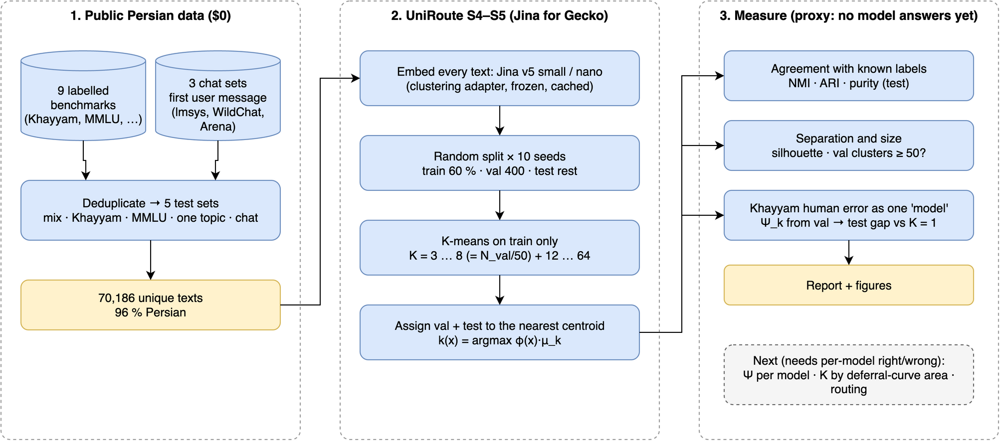

| Step | Paper | Here |
|---|---|---|
| Embedder | Gecko 1B, frozen, 768-d | Jina v5 text **small** (1024-d) and **nano** (768-d), frozen, `clustering` adapter; `text-matching` adapter as a reference |
| Split | random train / val / test, repeated 400× | train 60 % / **val 400** / test rest, repeated **10×** |
| K-means | on train only (no labels needed) | same; k-means++, 10 restarts |
| Assignment | nearest centroid | `argmax φ(x)·μ_k` (spec S5) |
| K candidates | 3 … N_val/50 | **3 … 8**, plus 12–64 and K = #labels for reference |
| K choice | largest area under the deferral curve | not possible yet (needs per-model answers) |

## 2. Data

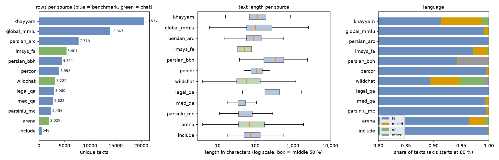

12 public Hugging Face sources; only the question or the first user message is used. Khayyam (38 school subjects,
native Persian, gated, access granted) is the largest. Chat messages are short on average but have a long
tail; benchmarks are short exam questions. 96 % of texts are Persian. Full table, licences and notes:
[`results/wp03b_persian/persian_data_card.md`](../../results/wp03b_persian/persian_data_card.md).

| Test set | Size | Plays the role of |
|---|---|---|
| mix (9 benchmarks, ≤ 4,000 each) | 28,802 | EmbedLLM (mix of benchmarks) |
| Khayyam | 20,577 | labelled subjects + examinee difficulty |
| Global-MMLU fa | 13,867 | 57 known subjects |
| one topic (Khayyam's largest category) | 1,672 | Headlines (one topic) |
| chat (lmsys, WildChat, Arena) | 10,651 | closest to Metis traffic; no labels |

## 3. Do the clusters follow real topics?

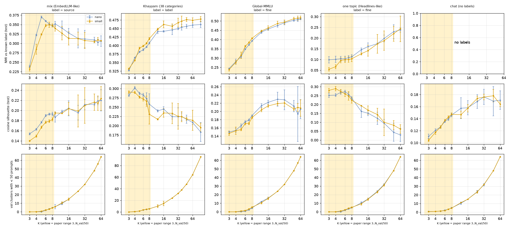

*Top: NMI between the clusters and the known label (0 = unrelated, 1 = identical). Middle: cosine silhouette
(how well separated). Bottom: how many of the K validation clusters have fewer than 50 prompts. Yellow = the
paper's K range for 400 validation prompts.*

- **mix:** NMI peaks at K = 5–8 (0.35–0.37). The 9 sources mostly separate.
- **Khayyam / Global-MMLU:** NMI keeps rising with K, because they have 38 / 57 real subjects.
- **one topic:** NMI ≈ 0.10, and separation falls quickly with K. There is little structure to find.
- **chat:** silhouette 0.10–0.15, lower than the benchmarks (0.15–0.30). The clusters are softer.

## 4. What is inside the clusters? (nano, K = 8, one split, test prompts)

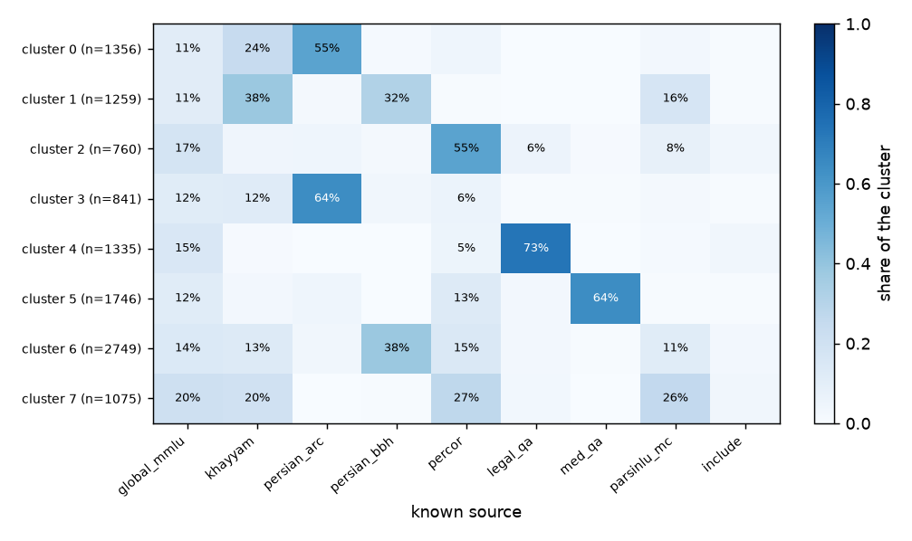

Most clusters are led by one source: legal QA 73 %, medical QA 64 %, Persian ARC 55–64 %, PerCoR 55 %.
Global-MMLU spreads over all clusters (11–20 % each), because it covers 57 subjects. Khayyam and BBH share
clusters (reasoning-style questions).

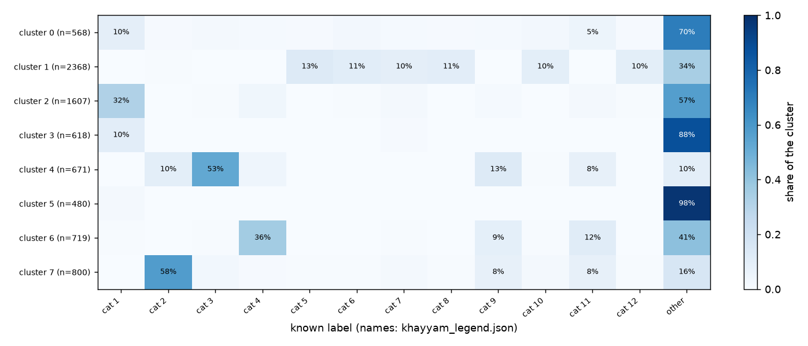

Khayyam categories: cat 1 Persian literature (upper secondary) · cat 2 physics · cat 3 chemistry · cat 4 biology
(upper secondary) · cat 5 math · cat 6 math & statistics (upper secondary) · cat 7 math & logic puzzles (upper
primary) · cat 8 math (lower secondary) · cat 9 science (lower secondary) · cat 10 math (upper primary) · cat 11
science (upper primary) · cat 12 geometry (upper secondary) · other = the 26 smaller categories.
**Physics, chemistry and Persian literature get their own clusters; all math categories merge into one (cluster 1)**,
regardless of grade. The embedder groups prompts by subject, not by school level.

## 5. Cluster maps

Each dot is one test prompt; position comes from UMAP (a 2-D projection of the embeddings). Left = the K-means
cluster (K = 8); right = the known label.

| | nano | small |
|---|---|---|
| mix | 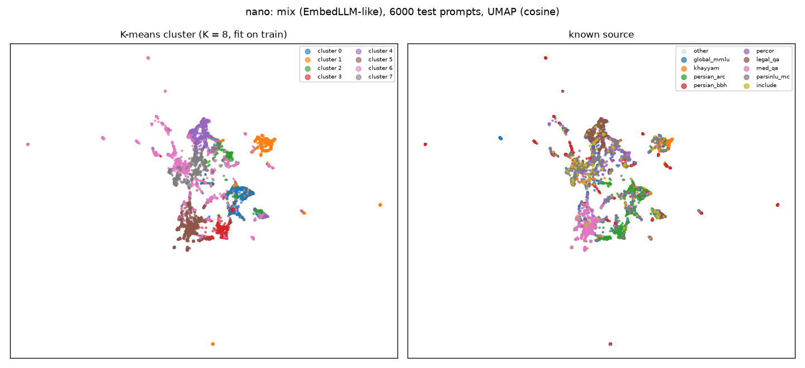 | 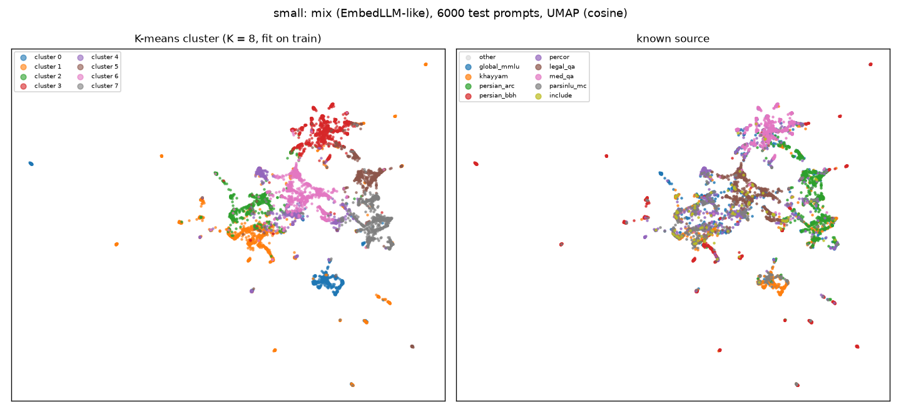 |
| Khayyam | 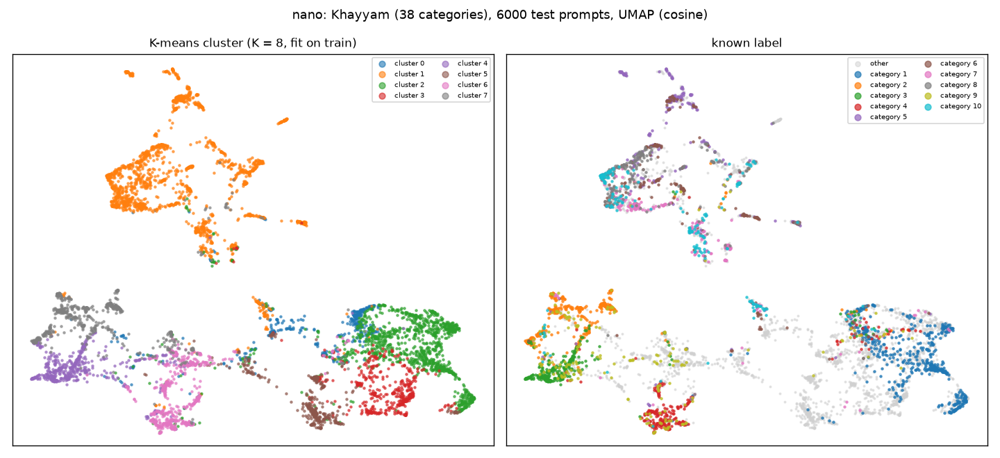 | 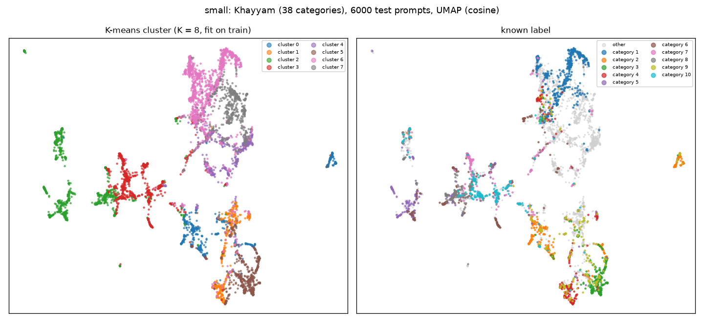 |
| chat | 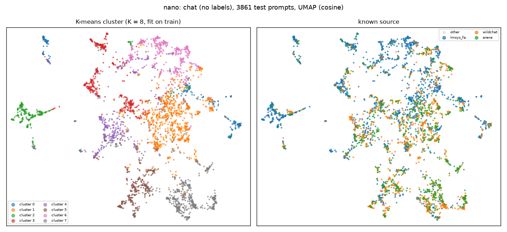 | 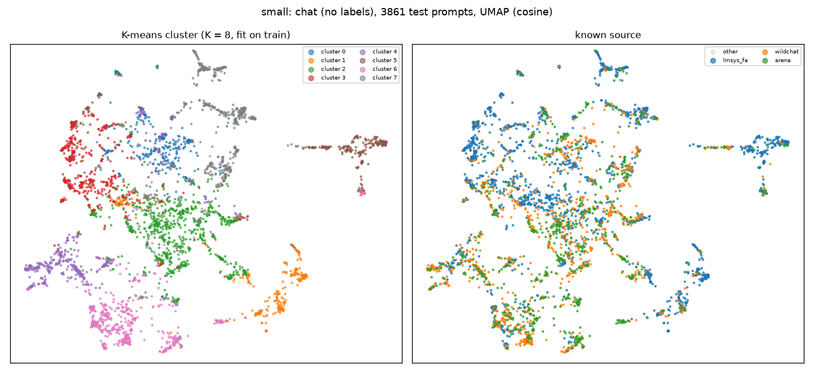 |

On the chat map the three chat sources are largely mixed (lmsys has a few regions of its own). The clusters split by *what people ask*, not by
where the data came from. Interactive maps (hover shows the text; local only, git-ignored):
`runs/s4/persian_map_{nano,small}.html`.

## 6. Would these clusters help routing? (human-difficulty test)

The paper's Prop. 2 says cluster routing works when each prompt's error is close to its cluster's average error. Khayyam
records what share of examinees chose the right answer. So we treat "examinees" as one model:
e(x) = 1 − share correct. Then Ψ_k is the average e over the 400 validation prompts in cluster k, and on test
prompts we measure how much |e(x) − Ψ_k(x)| shrinks compared with one average for everything (K = 1).

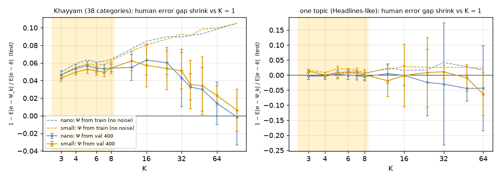

| Gap shrink vs K = 1 (nano) | K = 3 | K = 5 | K = 8 | K = 16 | K = 64 |
|---|---|---|---|---|---|
| Khayyam, Ψ from 400 val prompts | 4.7 % | 5.7 % | 5.4 % ± 0.4 | 6.3 % ± 1.7 | 1.4 % ± 2.4 |
| Khayyam, Ψ from the large train part | 5.0 % | 6.3 % | 6.4 % | 8.5 % | 9.8 % |
| one topic, Ψ from 400 val prompts | −0.3 % | 0.3 % | −0.5 % | −0.1 % | −4.3 % |

- **Clusters carry useful signal on a subject mix and none on a single topic.** This is the paper's EmbedLLM-vs-Headlines result.
- With only 400 validation prompts, more clusters mean fewer prompts per cluster. Above K ≈ 16 the noise eats the gain.
  With plenty of data (dashed lines) the gain keeps growing. **Validation size, not the embedder, limits K.**
- Clusters barely match Khayyam's difficulty *levels* (NMI ≈ 0.01). The gain comes from subjects differing in difficulty.

## 7. small vs nano (and the text-matching adapter)

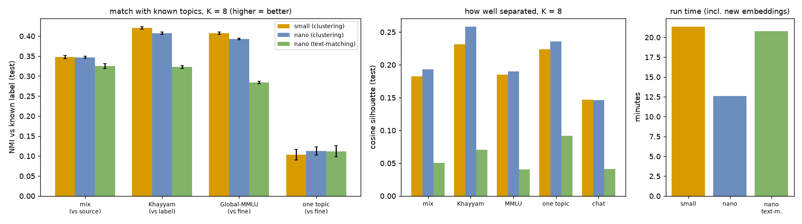

| K = 8 | small | nano | nano text-matching |
|---|---|---|---|
| NMI mix / Khayyam / MMLU / one topic | 0.348 / **0.420** / **0.407** / 0.104 | 0.347 / 0.407 / 0.393 / **0.113** | 0.325 / 0.323 / 0.284 / 0.112 |
| Silhouette chat | 0.147 | 0.146 | 0.041 |
| Khayyam gap shrink (Ψ from val) | 5.4 % | 5.4 % | **7.7 %** |
| Run time (whole test) | 21 min | **13 min** | 21 min |

small is slightly better on subject-rich sets; nano is better separated, better on the mix at K = 4–5, and
much faster. The `text-matching` adapter gives worse topic clusters and lopsided sizes. Oddly, it gives a slightly larger
difficulty gain; worth re-checking on real labels. The final embedder choice stays in WP-08 (D-052).

## 8. Are the clusters meaningful? (were prompts grouped correctly?)

Checked without reading any prompt, in three ways (nano, K = 8, one split, test prompts;
`scripts/s4_cluster_meaning.py`, `scripts/s4_chat_topics.py`; numbers in
`results/wp03b_persian/persian_cluster_meaning.json`, `results/wp03b_persian/persian_cluster_topics.json`).

**(a) Better than chance?** NMI of the clusters vs the known labels, and vs the same labels shuffled
(chance level): Khayyam subjects 0.405 vs 0.005 · Global-MMLU subjects 0.392 vs 0.015 · mix sources 0.350 vs 0.001.
So the clusters are far from random. Khayyam's *difficulty level* scores only 0.009: the clusters group by subject, not by difficulty.

**(b) Khayyam: each cluster has a clear subject** (8 clusters for 38 categories, so related subjects
must share). Share of a subject's questions that land in its main cluster:

| Cluster | What it contains (known labels) | Subject loyalty | Human error |
|---|---|---|---|
| 1 math (n = 2,368) | all math courses, every grade: calculus 99.6 %, upper-secondary math 95 %, discrete math 95 %, geometry 93 %, statistics 91 %, primary math 82–85 %, math & logic puzzles 79 % | very high | **0.71** (hardest) |
| 7 physics (800) | upper-secondary physics 58 % of the cluster; 83 % of all physics questions are here | high | 0.69 |
| 4 chemistry (671) | chemistry 53 % of the cluster; 87 % of all chemistry questions | high | 0.66 |
| 2 Persian literature (1,607) | literature at all 4 school levels (79–87 % each), verbal & analytical aptitude, logic | high | 0.57 |
| 6 biology (719) | biology 36 % (70 % of all biology), primary/lower science, geology, geography | medium | 0.57 |
| 5 history & society (480) | history 81 % of all history, sociology, social studies | medium | 0.58 |
| 3 religion & philosophy (618) | religion 83–100 %, philosophy 74 % | high | 0.56 |
| 0 humanities mix (568) | psychology, economics, some literature, social studies, geography | low (leftovers) | 0.54 |

Weakest: general science and social studies of the lower grades (30–37 % in their main cluster). They mix
physics, biology and geography, so splitting them is reasonable. **The clusters also differ in difficulty.**
Examinees get math and physics wrong far more often (0.69–0.71) than humanities (0.54–0.58). That is the
signal UniRoute uses for routing.

**(c) Global-MMLU (57 English-named subjects, machine-translated):** 0 economics & accounting & marketing ·
1 physics, chemistry, astronomy · 2 medicine, nutrition, biology · 3 history (world, US, European, prehistory) ·
4 mathematics & statistics · 5 law (85 % professional law) · 6 psychology, philosophy, sociology ·
7 moral scenarios (41 %) & ethics. Every cluster can be named. Medical (77 %) and business (77 %) questions land
mostly in one cluster each. "Humanities" splits into history, law and ethics, which are really different subjects.

**(d) mix (9 benchmarks):** legal QA (73 % of cluster 4), medical QA (64 % of cluster 5), Persian ARC science (clusters 0 and 3),
PerCoR news/commonsense (cluster 2, its domains are news sites). Reasoning puzzles (BBH: arithmetic, dates, object tracking,
logic) share clusters 1 and 6 with Khayyam math & logic. The clusters follow **what is asked**, not which dataset it came from.
Global-MMLU spreads across all clusters, because it covers many subjects.

**(e) Chat (no labels) → named by nearest topic.** We wrote 13 short topic descriptions (Persian + English)
and embedded them with the same model; each prompt gets the closest topic. **Check on Khayyam first:** the topic agrees with the
known subject for 72 % of questions (chance 19 %). So the method is usable, but rough.

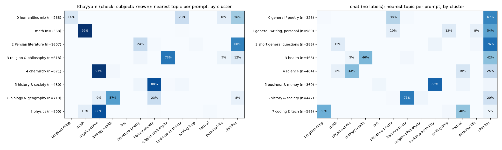

| Chat cluster | Size | Main topics | Supporting counts |
|---|---|---|---|
| 7 coding & tech | 586 | programming 50 %, AI / tech 40 % | most Latin script (10 %), most code markers, 11 % English/mixed |
| 5 business & money | 360 | business / economy 80 % | |
| 6 history & society | 442 | history / politics 71 % | 76 % lmsys |
| 3 health | 468 | health / medicine 46 % | |
| 4 science | 404 | physics / chemistry 43 %, tech 16 %, math 8 % | |
| 1 general, writing, personal | 989 | small talk 54 %, writing help 12 %, literature 10 %, personal 8 % | largest, all 3 sources |
| 0 general / poetry | 326 | small talk 67 %, literature / poetry 30 % | 82 % lmsys |
| 2 short general questions | 286 | small talk 76 %, math 12 % | 84 % lmsys, 66 % contain a question mark |

"Small talk" also catches anything that fits no topic, so clusters 0–2 are really "general / mixed". 5 of 8 chat clusters have
a clear topic. Clusters 0, 2 and 6 are mostly lmsys_fa (a translated set), so part of their grouping may be translation *style*,
not topic.

**Verdict.** On labelled data the clusters are **correct and nameable**: they gather questions of the same subject
far above chance, and they separate easy and hard subjects. Errors are sensible (neighbouring subjects merge, e.g.
all math; lower-grade "general science" splits). On chat, 5 of 8 clusters have a clear topic (coding/tech,
business, history/society, health, science) and 3 are general. **Only a human reading can confirm the chat names**:
please open `runs/s4/persian_clusters_nano.html` (8 random prompts per cluster) and check them.

## 9. Limits

- No per-model answers, so no deferral curve, no real K choice and no routing quality. NMI and the difficulty test are proxies.
- Exam questions are not chat; the chat set is the closest stand-in for Metis traffic.
- Global-MMLU is machine-translated; 111 (small) / 71 (nano) chat prompts were cut at 2,048 tokens for this test.
- 10 repeats (paper: 400); 3 repeats for K > 8, so those intervals are wider.

## 10. Next steps (proposals, need the owner's OK)

| Option | What | Cost |
|---|---|---|
| A. Paper's own data | Run the full UniRoute pipeline on EmbedLLM (public per-model right/wrong) and check we match the paper's numbers. This validates our code. | $0 |
| B. Persian end-to-end | Answer Khayyam / ARC / MMLU questions with 4–6 free open models on the Mac. Multiple choice is marked automatically, which gives a real Persian right/wrong table. Then Ψ per model, K by deferral area, routing, and the unseen-model test. | $0, Mac time |
| C. persian-llm-eval | Published per-question results for 17–20 models, ~294 questions | $0, too small for K = 8 |

All three need the router core first (WP-05). Owner question **Q-024**: keep "every val cluster ≥ 50"
(K = 3–4) or follow the paper (K ≤ N_val/50, average 50) with smoothing?

## Reproduce

```bash
uv run hf auth login                                      # once, for gated Khayyam
uv run python scripts/ext_download.py                     # 12 sources → data/external/ (git-ignored)
uv run python scripts/s4_persian_cluster.py small         # and: nano; nano --task text-matching
uv run python scripts/s4_cluster_plots.py                 # curves + maps (results/figures, runs/s4)
uv run python scripts/s4_report_figs.py                   # data overview, comparison, composition
uv run python scripts/s4_cluster_meaning.py               # label make-up per cluster
uv run python scripts/s4_chat_topics.py && uv run python scripts/s4_chat_topics_fig.py  # topic names
/opt/homebrew/bin/drawio -x -f png -s 2 -o report/persian_clustering/figures/pipeline.png \
  report/persian_clustering/figures/pipeline.drawio
```

Raw numbers: `results/wp03b_persian/persian_clustering_{small,nano,nano_text-matching}.json` · short version:
`results/wp03b_persian/persian_clustering.md`.
