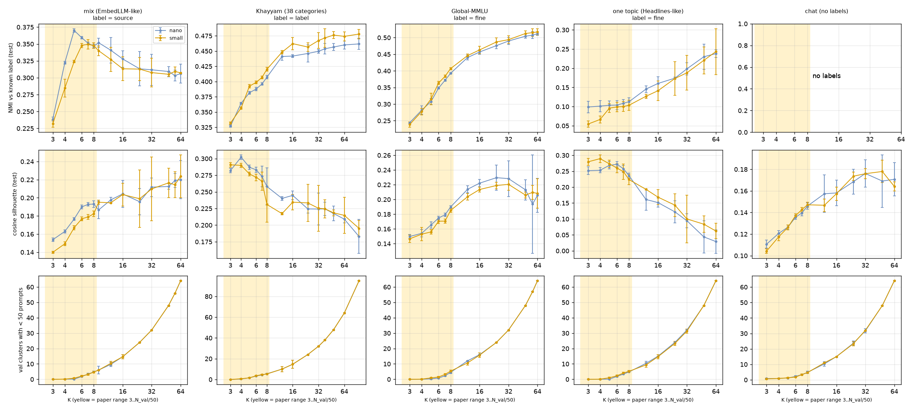
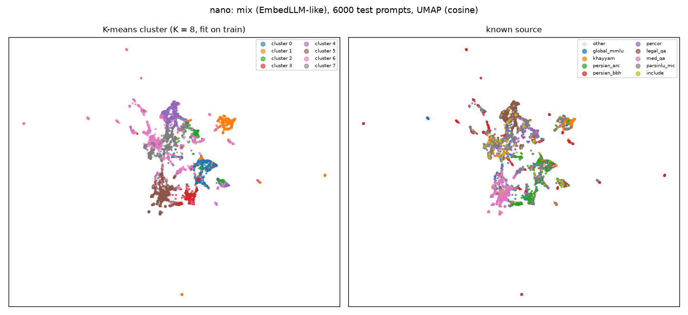
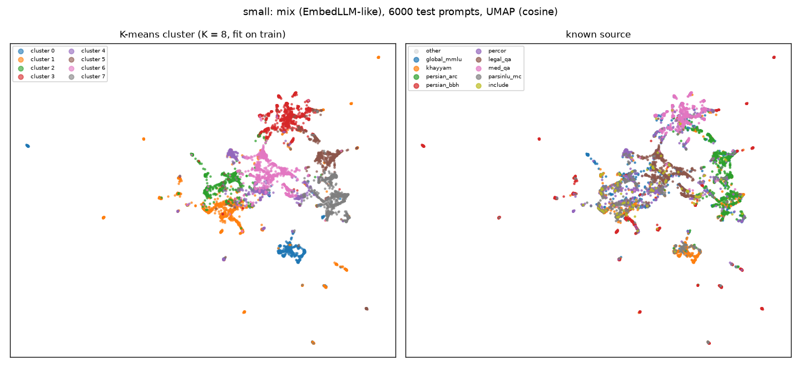
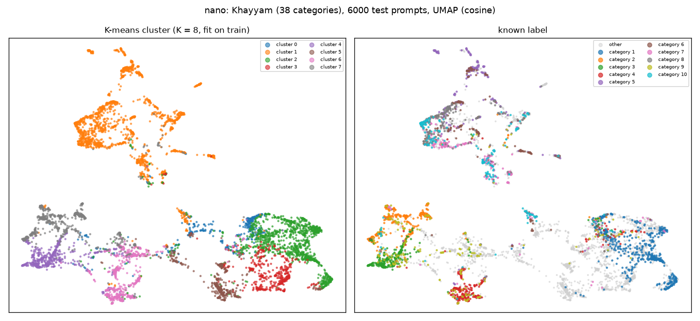
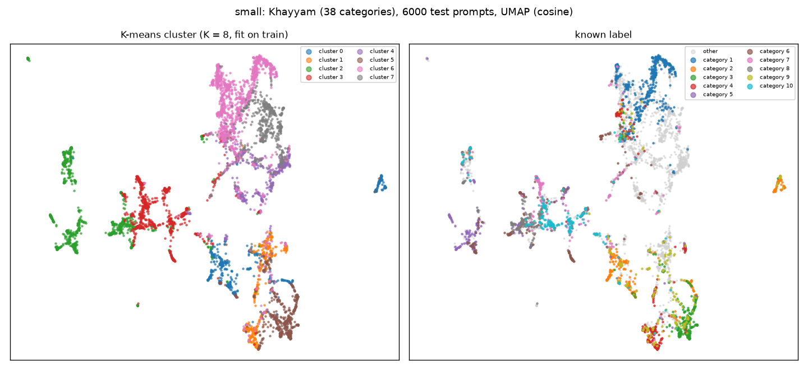
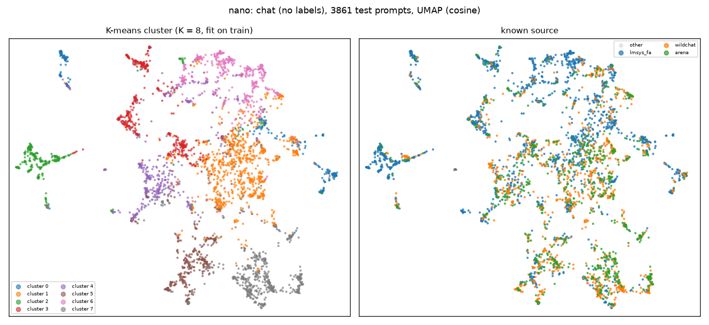
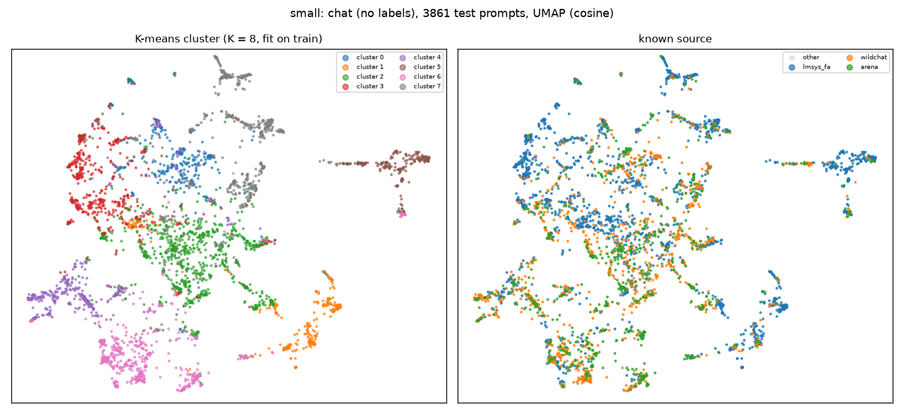
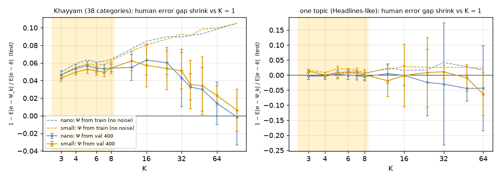

# Persian clustering test: the UniRoute paper's embedding + K-means step with Jina v5 (WP-03b)

Date 2026-10-25 · $0 (no LLM calls; public Hugging Face data, local embedding) · seed 20261020.
Scripts `scripts/ext_download.py`, `scripts/s4_persian_cluster.py`, `scripts/s4_cluster_plots.py`.
Raw numbers: `results/wp03b_persian/persian_clustering_{small,nano,nano_text-matching}.json`. All numbers are
**measured**, on the held-out test part, mean over 10 random splits (3 for K > 8) with a 95 % t-interval.

## 1. What we did (= paper §5.1, §6, App. G.1–G.3, Gecko → Jina)

| Step | Paper | Here |
|---|---|---|
| Embedder | Gecko 1B, frozen, 768-d | Jina v5 text **small** (1024-d) and **nano** (768-d), frozen, `clustering` adapter (merged), as `configs/pipeline.yaml s4`; `text-matching` adapter as a reference (nano) |
| Split | random train / val / test, repeated (EmbedLLM 60/10/30; Headlines 4,000/400/5,600; 400 trials) | train 60 % / **val 400** / test rest, **10 repeats** |
| K-means | on train only, unlabeled | same; k-means++, 10 restarts |
| Assign | nearest centroid | `argmax φ(x)·μ_k` for val and test (spec S5) |
| K grid | 3 … N_val/50 | **3–8**, plus 12–64 and K = #labels for reference |
| Choose K | area under deferral curve (needs model correctness labels) | **not possible at $0**; replaced by label agreement and a human-difficulty test (§3) |

Data (deduplicated, question text only; full description in `persian_data_card.md`): **mix** = 9 benchmarks, ≤ 4,000 each (28,802; EmbedLLM-like) ·
**Khayyam** 20,577 (38 categories, 95 courses; gated, access granted) · **Global-MMLU fa** 13,867 (57 subjects) ·
**one topic** = Khayyam's largest category, 1,672 (Headlines-like) · **chat** = first user message of
Persian lmsys 5,401 + WildChat 3,222 + Arena 2,028 = 10,651 (no labels).

## 2. Results

NMI of test clusters vs the known label (higher = clusters follow the real topics), K = 8:

| Set (label) | small | nano | nano text-matching |
|---|---|---|---|
| mix (source, 9) | 0.348 ± 0.004 | 0.347 ± 0.003 (peak 0.370 at K = 5) | 0.325 |
| Khayyam (38 categories) | **0.420** ± 0.003 | 0.407 ± 0.003 | 0.323 |
| Global-MMLU (57 subjects) | **0.407** ± 0.003 | 0.393 ± 0.002 | 0.284 |
| one topic (6 courses) | 0.104 ± 0.013 | 0.113 ± 0.011 | 0.112 |
| chat: cosine silhouette | 0.147 | 0.146 | 0.041 |

Cluster maps (UMAP of 6,000 test prompts, K = 8; left = cluster, right = known label):

| | nano | small |
|---|---|---|
| mix |  |  |
| Khayyam |  |  |
| chat |  |  |

Khayyam "category n" names: `figures/persian_map_khayyam_legend.json`.

## 3. Does clustering help routing? (human-difficulty test, Khayyam)

The paper's bound (Prop. 2, Remark C.1): cluster routing is good when a prompt's error is close to its
cluster's average error. Khayyam records the share of examinees who chose the right answer, so
"human examinees" act as one model: e(x) = 1 − share correct; Ψ_k = mean e over the **val** prompts of
cluster k (Eq. 12); we measure on test how much E|e(x) − Ψ_k(x)| shrinks compared with K = 1 (ZeroRouter).

| | K = 3 | K = 5 | K = 8 | K = 16 | K = 64 |
|---|---|---|---|---|---|
| Khayyam, nano, Ψ from val 400 | 4.7 % | 5.7 % | 5.4 % ± 0.4 | 6.3 % ± 1.7 | 1.4 % ± 2.4 |
| Khayyam, nano, Ψ from train (no noise) | 5.0 % | 6.3 % | 6.4 % | 8.5 % | 9.8 % |
| one topic, nano, Ψ from val 400 | −0.3 % | 0.3 % | −0.5 % | −0.1 % | −4.3 % |

## 4. What this tells us (plain)

1. **The paper's picture holds for Persian with Jina.** A mix of subjects gives real clusters (EmbedLLM-like);
   one topic gives almost nothing (Headlines-like: NMI ≈ 0.1, no difficulty gain). Chat sits in between
   (silhouette 0.10–0.15, below the benchmarks' 0.15–0.30): clusters exist but are softer.
2. **small ≈ nano.** small is +0.01–0.015 NMI on Khayyam/MMLU at K = 8; nano is better on the mix at
   K = 4–5. Difficulty gains are the same within the CI. nano embeds ~2.5× faster (whole run 13 vs 21 min).
   For clustering alone this favours **nano** (input for D-052 / WP-08; not decided here).
3. **Clusters follow subjects, not difficulty.** NMI vs Khayyam's difficulty level is ≈ 0.01. Clusters still
   cut the human-error gap by ~5–6 %, because subjects differ in difficulty.
4. **Why the paper caps K at N_val/50:** with Ψ from 400 val prompts the gain stops rising after K ≈ 8–16 and
   then falls (noise), while Ψ from the big train part keeps rising. Our val size, not the embedder, limits K.
5. **Spec check |C_k| ≥ 50 is stricter than the paper.** With val 400, K = 8 always has ~5 of 8 clusters under
   50 val prompts, and K ≥ 5 often has at least one. The paper's rule K ≤ N_val/50 means *50 on average*. If
   S5 keeps "every cluster ≥ 50", only K = 3–4 survive with val 400. → **Q-024**, decided: follow the paper (below).
6. **text-matching adapter:** worse topic clusters (NMI −0.08 to −0.12, very low silhouette, lopsided sizes),
   but a slightly larger Khayyam difficulty gain (7.7 % at K = 8). A curiosity to re-check on real data with real
   labels (WP-14); the `clustering` adapter stays the default.

## 5. Limits

- No model answers, so no deferral curve and no real K choice; NMI and the human-difficulty test are proxies.
- One run per (K, split) of K-means with 10 restarts; 3 splits for K > 8 (wider CIs there).
- Benchmarks are exam questions; real Metis traffic is chat-like (closest here: the chat set).
- 111 (small) / 71 (nano) chat prompts are longer than 2,048 tokens and were truncated for this test only.
- Global-MMLU is machine-translated; Khayyam and ParsiNLU are native Persian.

## Owner questions

- **Q-024 decided (D-054, 2026-10-30):** follow the paper: K ≤ N_val/50 (average ≥ 50), no per-cluster
  minimum, α = 0 (Eq. 12).
- Look at `runs/s4/persian_map_{nano,small}.html` (interactive maps; hover shows the text, local only) and
  `runs/s4/persian_clusters_{nano,small}.html` (8 random prompts per cluster): are the chat clusters nameable?
